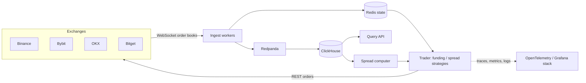

# cross-exchange-arbitrage

Spatial and funding-rate arbitrage across crypto exchanges: WebSocket order-book mirroring, Redpanda→ClickHouse streaming, SOPS-encrypted config and Kamal deploys.

[](https://github.com/nicolasMazuryk/cross-exchange-arbitrage/actions/workflows/ci.yml)
[](LICENSE)

## The problem

The same perpetual future trades at slightly different prices, and pays different funding rates, on different exchanges. Capturing that gap means watching several order books at once, deciding fast whether the spread covers fees and slippage, and placing both legs with risk limits. This project does that for Binance, Bybit, OKX and Bitget.

## How it works



- **Strategies:** `funding` (funding-rate differential) and `spread` (price spread), selected with `STRATEGY` and per-strategy YAML in `config/`.
- **Adapters:** `src/adapters/{rest,websocket}` hold one adapter per exchange behind a common interface.
- **Core:** `src/core` has order-book mirroring, opportunity detection, risk checks, order orchestration and state recovery.
- **Observability:** OpenTelemetry traces, Prometheus/Loki/Tempo/Pyroscope and Grafana dashboards in `docker/obs`.
- **Deploy:** Docker images shipped with Kamal; config and secrets are SOPS+age encrypted (`config/secrets`, `infra/ansible`).

## Stack

TypeScript, Node.js, ccxt and exchange SDKs, Redis, Redpanda, ClickHouse, OpenTelemetry, Terraform, Ansible, Kamal, SOPS.

## Getting started

Requires Node.js 24 and Docker.

```bash
npm ci
cp .env.example .env     # fill in exchange API keys; never commit .env
npm run build
npm start                # ts-node, uses config/development.yaml
```

The full local stack (Redpanda, ClickHouse, trader, query API, spread computer and the observability stack):

```bash
npm run docker:dev:up    # decrypts config/secrets/dev.env.sops.yaml with SOPS_AGE_KEY_FILE
```

The SOPS files are encrypted to the author's age key, so to run the stack yourself, replace them with your own (`.sops.yaml`) or just fill `.env`.

Credentials are read from the environment only (see `.env.example`); Docker images contain none.

## Layout

```
src/            adapters, core logic, ingest workers, services (trader, queryApi, spreadComputer)
config/         per-strategy YAML, Kamal deploy config, encrypted secrets
docker/         Dockerfiles, observability stack
infra/          Terraform, Ansible, Kamal scripts
docs/           architecture, strategies, risk, data models
.bmad/          BMAD method workflows used during development
```

## Design decisions

See [docs/architecture.md](docs/architecture.md), [docs/trading-strategies.md](docs/trading-strategies.md) and [docs/risk-management.md](docs/risk-management.md).

## Limitations

- Research/engineering project, not financial advice; live trading carries real risk.
- No automated test suite yet; CI runs lint and the TypeScript build.
- Some experimental code is intentionally left commented out.
- Lint reports pre-existing warnings (unused variables); they are not errors.

## License

[MIT](LICENSE)
