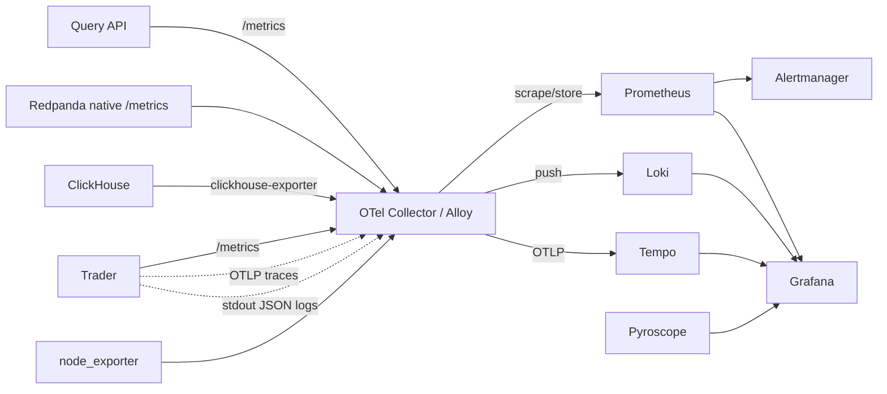

# Observability

## Context & Constraints

- **System:** Arbinet — an automated, algorithmic crypto price arbitrage trading system that connects to multiple crypto exchanges, detects price differences in real time, and places orders programmatically.
- **Sensitivity:** Latency- and reliability-sensitive. Instrumentation must be low-overhead and must not impede the hot trading path.
- **Hosting:** Hetzner Cloud.
- **Scope of this document:** Capture observability preferences and requirements for both application and infrastructure as input to a later technical-specification phase. This is *not* the specification itself; tool selections marked as open are deferred to that phase.

## Instrumentation Standard

- **OpenTelemetry (OTel)** is the instrumentation standard across application and infrastructure.
- **Context propagation:** W3C TraceContext.

## Telemetry Signals

The stack is organized around four primary signals plus continuous profiling.

| Signal | Purpose | Preferred Tooling | Backend / Store | Visualization |
|---|---|---|---|---|
| Metrics | Quantitative health & performance | Prometheus; node_exporter (host metrics) | Prometheus | Grafana |
| Logs | Discrete event detail | Vector *or* Fluent Bit (shipping) | Loki | Grafana |
| Traces | Request/operation flow | OpenTelemetry SDKs + Collector | Tempo | Grafana |
| Profiles | CPU/memory/lock behavior over time | Grafana Pyroscope; Parca (eBPF) | (per tool) | Grafana |

### Metrics

- Collection and storage: **Prometheus**.
- Host / node metrics: **node_exporter**.
- Alerting: **Prometheus Alertmanager**.
- Visualization: **Grafana**.

### Logs

- Storage and query: **Loki**.
- Shipping / processing: **Vector** or **Fluent Bit** (selection deferred).
- Visualization: **Grafana**.
- Logs must carry `trace_id` and `span_id` for correlation (see Cross-Signal Correlation).

### Traces

- Instrumentation: **OpenTelemetry SDKs**.
- Pipeline: **OpenTelemetry Collector**.
- Storage / backend: **Tempo**.
- Propagation: **W3C TraceContext**.

### Profiles (Continuous Profiling)

Continuous profiling targets the following problem classes:

- CPU hotspots
- Memory leaks
- Lock contention
- Performance regressions

Tooling: **Grafana Pyroscope** and **Parca**, with **eBPF** as the key enabling technology.

### eBPF Observability

- **Parca** (eBPF-based) provides eBPF-driven observability.

## Collection Pipeline

- **OpenTelemetry Collector**, *or* the newer **Grafana Alloy** as a unified collector (selection deferred).

## Dashboards & Visualization

- **Grafana** is the single pane of glass across metrics, logs, traces, and profiles.

## Events, Errors & Incident Response

| Concern | Tool |
|---|---|
| Alerting | Prometheus Alertmanager |
| Error tracking | Sentry |
| Incident routing / on-call | Grafana OnCall |

## Cross-Signal Correlation

Treated as a foundational principle: the stack's return on investment lives in *navigation* across signals — from a metric anomaly, to the offending trace exemplar, to the correlated logs for that `trace_id`, to the flame graph for that span.

- `trace_id` and `span_id` must flow through **every** signal.
- Always inject `trace_id` and `span_id` into logs; uncorrelated logs turn debugging into archaeology.
- Enablers: **OpenTelemetry exemplars** (trace IDs embedded in Prometheus histograms) and **Grafana data links** for click-through navigation.

## SLOs & Burn-Rate Alerting

Also treated as a foundational principle: define service-level objectives, not just raw threshold alerts.

- Define **SLIs** (e.g., error rate, latency P99) and corresponding **SLOs**.
- Prefer **SLO burn-rate alerts** (Prometheus recording rules + Alertmanager; alternatives: Datadog SLOs, Nobl9) over raw threshold alerts.
- A burn-rate alert fires when the error budget is being consumed too fast — generally more actionable than a threshold alert and a significant reducer of alert fatigue.

## Signal Prioritization & Guiding Principles

- **Priority order:** Metrics → Traces → Profiles → Logs.
- Logs are expensive noise; avoid overusing them.
- Never skip trace correlation.

## Open Questions / Decisions to Resolve

| Decision | Options |
|---|---|
| Log shipper | Vector **vs.** Fluent Bit |
| Collection pipeline | OpenTelemetry Collector **vs.** Grafana Alloy |

| Decision | Decided |
|---|---|
| Profiling tool | Grafana Pyroscope |
| SLO tooling | Prometheus recording rules + Alertmanager |

---

## Arbinet Metric Catalog, SLIs/SLOs, Alerts & Dashboards

Concrete observability requirements for the Arbinet trader + orderbook pipeline. Everything here is the **collection / alert / dashboard** side, scraped into the **self-hosted** stack (Prometheus + Alertmanager + Loki + Grafana; agents run on-host per [ansible-configuration.md](./ansible-configuration.md#observability_agents)).

> **Ownership split.** The metric *names* each app service emits are an app **instrumentation contract** (see [`../../specs/datapipeline/08-observability.md`](../../specs/datapipeline/08-observability.md)). Scraping, alerting, dashboards, and cardinality budgeting are infra and live here.

### Collection topology

### Metric catalog

#### Trader / snapshotter / spread engine (app `/metrics`)

| Metric | Type | Purpose |
|---|---|---|
| `snapshotter_drop_total{reason}` | Counter | Snapshot drops |
| `snapshotter_tick_lag_seconds` | Gauge | now − last tick |
| `snapshotter_rows_emitted_total{exchange}` | Counter | Throughput |
| `sequence_gap_total{exchange,symbol,type}` | Counter | WS continuity |
| `spread_engine_drop_total{reason}` | Counter | Spread drops |
| `spread_engine_rows_emitted_total` | Counter | Throughput |
| `exchange_clock_skew_seconds{exchange}` | Histogram | `ts − ts_exchange` p50/p95 |
| `ws_health{exchange}` | Gauge | 1 = up, 0 = down |
| `arb_opportunities_detected_total{strategy}` | Counter | Engine output |
| `trade_executions_total{result}` | Counter | Hot path |

#### Redpanda (native Prometheus endpoint)

| Metric | Threshold |
|---|---|
| `redpanda_kafka_under_replicated_partitions` | always 0 (single replica) |
| `redpanda_producer_queue_bytes` | alert >40 MB |
| `redpanda_kafka_consumer_group_lag` | alert >5 s |
| `redpanda_disk_free_bytes` | alert <50 GB |

#### ClickHouse (`clickhouse-exporter`)

| Metric | Threshold |
|---|---|
| `clickhouse_query_duration_p95` | alert >5 s |
| `clickhouse_inserted_rows_total` | sanity |
| `clickhouse_parts_active` | alert >300 per table |
| `clickhouse_async_insert_pending_bytes` | sanity |
| `mv_freshness_seconds{view}` | derived: `now() − max(bucket)` |
| `clickhouse_s3_disk_get_requests_total` | cold-tier cost watch |

#### Query API (app `/metrics`)

`qapi_http_duration_seconds{route}` (histogram), `qapi_ws_clients`, `qapi_ws_messages_pushed_total{channel}`, `qapi_ch_errors_total{route}`, `qapi_cache_hits_total{route}`.

#### Host (`node_exporter`)

Standard CPU/mem/disk/net, plus: `node_disk_io_time_seconds_total` per device (NVMe vs Volume), `node_filesystem_avail_bytes{mountpoint="/mnt/ch-volume"}`, `chrony_tracking_last_offset_seconds`.

### SLIs / SLOs

| SLI | Target (SLO) |
|---|---|
| Snapshot tick lag | < 1 s p99 |
| Snapshot drop rate | < 0.1 % over 5 min |
| Spread emit drop rate | < 0.1 % over 5 min |
| CH consumer lag | < 5 s p99 |
| MV freshness (per tier) | < 3× bucket size |
| Exchange clock skew | < 200 ms p95 |
| Query API latency | < 500 ms p95 HTTP, < 100 ms WS push age |
| WS health | > 99 % per exchange |

Express these as Prometheus **recording rules + SLO burn-rate alerts** (per the foundational principle above), not just raw thresholds.

### Alert rules (Alertmanager)

| Alert | Rule | Severity |
|---|---|---|
| snap_drops | `increase(snapshotter_drop_total[5m]) / increase(snapshotter_rows_emitted_total[5m]) > 0.001` | warn |
| ingest_lag | `redpanda_kafka_consumer_group_lag{group=~"ch_.*"} > 5` for 2 min | warn |
| mv_stale | `mv_freshness_seconds{view="spreads_15s"} > 45` for 2 min | warn |
| clock_skew | `histogram_quantile(0.95, exchange_clock_skew_seconds) > 0.2` for 5 min | info |
| ws_down | `ws_health == 0` for 1 min | crit |
| ch_query_slow | `histogram_quantile(0.95, clickhouse_query_duration_seconds) > 5` for 5 min | warn |
| disk_low | `node_filesystem_avail_bytes{mountpoint="/mnt/ch-volume"} < 100 GB` | warn |
| trader_down | absence of `snapshotter_rows_emitted_total` for 30 s | crit |

`disk_low` is the trigger for Volume expansion ([capacity-and-cost.md](./capacity-and-cost.md#capacity-headroom--scaling-triggers)).

### Dashboards

1. **Hot path** — WS health, opportunity rate, trade executions, latency to exchange.
2. **Warm path** — snapshot/spread emit rate, drop rate, Redpanda lag, MV freshness, CH inserts/s.
3. **Capacity** — disk, RAM, CPU per service, Redpanda buffer, CH parts.
4. **Trader UI live** — spread top-50, per-pair history (mirror of UI queries).

### Series-cardinality budget

Self-hosted Prometheus has no SaaS per-series fee, but cardinality still bounds memory/TSDB cost. Track active series and keep host RAM within the [capacity-and-cost.md](./capacity-and-cost.md#process-resource-boundaries) observability budget (~200 MB agents).

| Source | Approx series |
|---|---|
| Trader (per-exchange, per-symbol top contributors) | ~2 k |
| Snapshotter (per-exchange) | ~50 |
| Spread engine | ~50 |
| Redpanda | ~500 |
| CH exporter | ~1 k |
| Query API (per-route) | ~50 |
| node_exporter | ~500 |
| **Total** | **~4–5 k** |

If series growth threatens host RAM, prune high-cardinality labels first — e.g. `sequence_gap_total{symbol}` → `{exchange}` (drop the `symbol` label).

## Links

- Agents that collect this → [ansible-configuration.md](./ansible-configuration.md#observability_agents)
- Resource budget for the on-host stack → [capacity-and-cost.md](./capacity-and-cost.md)
- App instrumentation contract (metric names emitted) → [`../../specs/datapipeline/08-observability.md`](../../specs/datapipeline/08-observability.md)