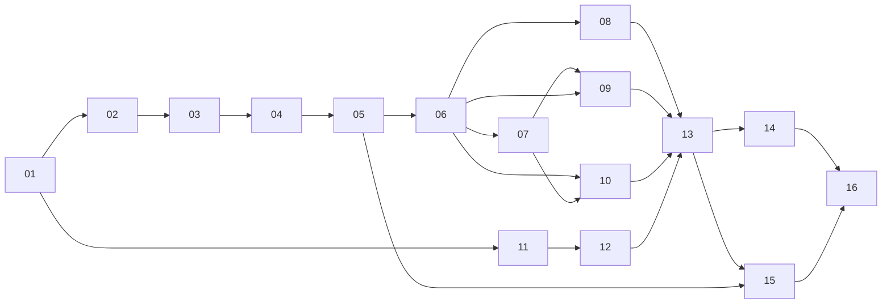

# Infrastructure Implementation Plan — Overview

## Feature summary

Stand up the ARBINET **provision → configure → deploy → observe** architecture on Hetzner
Cloud: a three-host topology — lean dedicated-vCPU **hot box** (CCX13, trader only), shared-vCPU
**core box** (CPX51: ClickHouse + Redpanda + query-api + spread-computer + kamal-proxy), and
**obs box** (CPX41 amd64: Prometheus/Loki/Tempo/Pyroscope/Alertmanager/Grafana/GlitchTip) — across
four pillars: **Terraform** (provisioning), **Ansible** (configuration), **Kamal** (deployment +
thin app stubs), and **self-hosted OTel** (observability), plus runbooks and capacity/cost. The
private network is load-bearing: it carries the warm `ob.ticks` path (hot → core Redpanda), the
trader↔ClickHouse trade-state flow, and Alloy→obs telemetry. This plan produces the ordered task
files; it does **not** implement the infra — each task is executed later, one at a time.

This is the **first of two sequential workstreams**; the datapipeline spec set is the second and
depends on this infra being live. Real app/arbitrage/schema logic is datapipeline-owned — here we
author only **thin app stubs** (boot + `/up` + `/metrics` + a dummy `ob.ticks` tick + CH ping) so
deploy and healthchecks are observable end-to-end.

## Verification model (applies to every task)

- A single **throwaway "prod" Hetzner environment** (labelled `env=prod`, but disposable) is brought
  up incrementally. Tasks 02→16 apply onto it in order; it stays up for the next task.
- Each task's Verification Criteria = "apply/configure my slice **live**, then observe real values"
  (resource exists in `hcloud`, port answers, metric appears in Prometheus, `--check` reports 0
  changed, etc.). Every task includes **at least one executed-at-runtime check** with real values
  printed.
- Verification is **CLI/observation only**: `terraform validate/plan/apply`, `hcloud ...`,
  `ansible-playbook --check --diff` / Molecule, `ssh`, `curl`, `promql`, `kamal ... status`,
  `docker buildx`/`docker run`. **No mcp-debugger** — that tool is for Node app runtime state and is
  N/A for infra.
- **Authoring-only tasks** (11 stubs/Dockerfiles, 12 deploy.yml) verify without live cloud:
  `docker buildx` produces an amd64 image that boots and answers `/up`; `kamal config` parses.
- **Capstone task 16** runs the full provision→configure→deploy→observe on a fresh ephemeral env,
  spot-checks failure isolation, then `terraform destroy` (teardown verified).

## Ordered task list

| # | Title | One-line |
|---|---|---|
| 00 | Overview | This file. |
| 01 | Credentials, accounts & SOPS prerequisites | Gather creds, stand up SOPS/age, manually bootstrap the tfstate bucket. |
| 02 | Terraform skeleton | `versions/backend/variables/outputs/main.tf` + `modules/` scaffold; `init` against live state. |
| 03 | Network + firewall modules | `prod-vpc` + subnet; 3 parametrized firewalls (hot/core/obs). |
| 04 | Host module + cloud-init | `modules/host` (server+volume+attach+labels+user_data) + minimal cloud-init. |
| 05 | Root composition + full provisioning apply | Compose 3 hosts + 2 volumes + net + 3 fw + 2 buckets + ssh key; **no LB**. Leave env up. |
| 06 | Ansible scaffold + dynamic inventory + baseline + wireguard | `ansible.cfg`/`requirements.yml`/`hcloud.yml`/`site.yml` + baseline + WG on all 3 hosts. |
| 07 | Obs-box backend stack roles | prometheus/loki/tempo/pyroscope/alertmanager/grafana/glitchtip compose stack on obs. |
| 08 | Core-box data middleware roles | chrony + clickhouse + redpanda roles (config-on-host only). |
| 09 | Core-box app-support + telemetry roles | spread-computer + kamal_proxy + core Alloy (+ node/clickhouse exporters). |
| 10 | Hot-box roles (lean) | chrony + lean Alloy (+ node_exporter). Configuration pillar done. |
| 11 | App stubs + Dockerfiles + bootstrap.sql | Minimal trader/queryApi/spreadComputer entrypoints + 3 amd64 Dockerfiles + `bootstrap.sql`. |
| 12 | Kamal deploy config | `deploy.yml`: trader→hot, queryapi/spreadcomputer→core, CH+Redpanda accessories, GHCR, secrets. |
| 13 | Kamal deploy execution + edge/TLS + smoke test | Build→push GHCR→`kamal deploy`; LE cert on core; smoke. |
| 14 | Observability wiring & validation | Scrape configs, metric catalog, recording rules + SLO burn-rate alerts, dashboards, cardinality. |
| 15 | Runbooks, drift detection & local-dev stack | Author runbooks, nightly `--check --diff` drift job, reconcile dev compose. |
| 16 | End-to-end live bring-up & teardown (capstone) | Full chain from zero; failure-isolation assertion; `terraform destroy`. |

## Dependency map



- **01** has no deps. **11** is parallelizable with Pillars 1–2 (no cloud dependency).
- **02→05** are the Terraform chain (provisioning); **05** leaves the env up for Pillar 2.
- **06** is the Ansible foundation; **07/08/10** layer on it; **09** also needs **07** (forwards to obs).
- **12** needs **11** (images) + **01** (secrets); **13** needs **12** + the core/hot config (**08/10**).
- **16** is the capstone and depends transitively on all (01–15).

## Coverage check

Every spec file maps to ≥1 task: README/01 → 00 + all; 02 → 02–05; 03 → 06–10; 04 → 11–13;
05 → 07, 14; 06 → 04/05/08/14/15 + overview; 07 → 15, 16; 08 → overview + embedded across tasks.
Capacity/cost (06) and the gaps register (08) are **cross-cutting** — no standalone task: SKUs/volume
sizes → 04/05; CH/Redpanda limits → 08; cardinality + scaling-trigger alerts → 14; scaling-trigger
runbook actions → 15; budget + open gaps recorded below.

## Open Questions / Assumptions

These are the unresolved-input gaps from the spec ([08-gaps-and-decisions.md](../../specs/infrastructure/08-gaps-and-decisions.md)).
Proceed on the spec's stated decisions as **assumptions**; the listed input is needed before the
noted task can be finalized.

- **G5 — host-managed LE cert (core box).** Assume a kamal-proxy-managed Let's Encrypt cert on the
  core box is acceptable (no specific CA/SAN requirement). *Needed before:* 13.
- **G7 — registry = GHCR + credential location.** Assume GHCR (`ghcr.io/nicolasmazuryk/...`) with a
  PAT (`read/write:packages`) in Kamal secrets; org-PAT vs per-developer unconfirmed. *Needed before:* 11/12/13.
- **G10 — cold tier as sole durable copy.** Assume `arbinet-cold` Parquet is the only durable copy
  (no CH backups / Volume snapshots). Recorded residual risk; lives on the core box. *Needed before:* 05/15.
- **G11 — operator-IP allowlist.** Assume `operator_ips` is a static office/VPN egress set so UDP
  51820 + SSH 22 can be IP-pinned on all three firewalls. *Needed before:* 03/05/06.
- **G13 — hot-box RSS measurement.** Assume CCX13 (8 GB) holds; the real trader RSS is only
  measurable once the datapipeline G12 split ships. CCX23 is the defined fallback. *Needed before:*
  confirming hot-box SKU; measure at runtime (14/16).

**Deferred observability inputs** (business/target-state, not derivable from code; from
[05 §open-questions-deferred](../../specs/infrastructure/05-observability.md#open-questions-deferred)):

- `drawdown_breach` / `exposure_breach` dollar thresholds (`<X>`) — risk-appetite business input; set
  before enabling those page-now alerts (task 14).
- `trade_executions_total{result}` / `order_fills_total{status}` enum domains and
  `trade_hold_duration_seconds{exit_reason}` domain — target-state; current `TradeResult` carries only
  `success: boolean`. App-instrumentation contract, datapipeline-owned (task 14 references, does not author).

**Datapipeline-owned prerequisite (not authored here):** the **G12 SpreadComputer split + serviceless
raw `orderbooks` path** is referenced, not built, by this plan. No `spreadComputer`/`snapshotter`
exists in `src/` today; the stub (task 11) only proves the seam. `ob.ticks` topic DDL is
datapipeline-owned — the stub may need an auto-create or a manually-created topic for produce to land.
```
