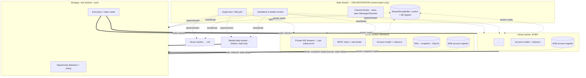
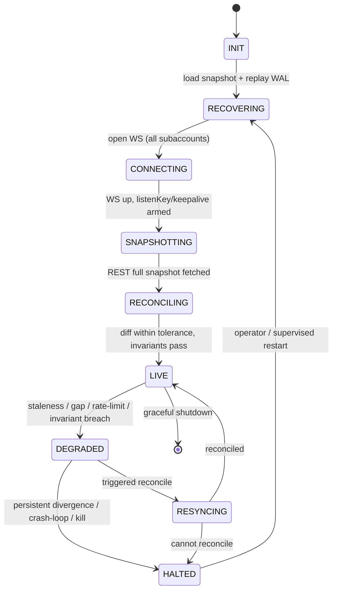

# 01 — Architecture & Canonical Data Model

**Scope:** governing axioms, process topology and decomposition, orchestration and supervision, the single-writer actor discipline, the venue adapter (anti-corruption) layer, the canonical event/data model, numeric (money) discipline, and market-type normalization. Runtime: Node.js / TypeScript, single host, single region, ~15 venues × multiple subaccounts, `worker_threads` spawned from one orchestrator process. Cross-references: connection lifecycle → `02`, order/fill/position lifecycles → `03`, capital → `04`, reconciliation/invariants → `05`, persistence → `06`, failure handling/breakers/kill → `07`, observability/testing/venue notes → `08`.

---

## 1. Governing axioms (everything below serves these)

There is exactly one source of truth: **the venue.** Local state is a *cache with a confidence level* — allowed to be fast, never allowed to be silently wrong. When correctness and latency conflict, correctness wins, and "wrong" must always be loud (degrade + halt), never quiet. Every design decision answers two questions at all times: *Is my local view currently trustworthy enough to trade on?* and *If not, how fast can I either re-establish trust or stop trading?*

Treat these as laws, not preferences:

1. **Events are hints, not truth.** Every WS user-data stream drops messages, reorders, duplicates, and silently dies. Design *as if* every event can be lost, because it can. The stream makes you fast; reconciliation makes you correct. Reconciliation is not a cleanup job — it is the backbone: the stream is an optimization bolted on top of a system that would still be correct (just slower) on REST polling alone. If you can't describe the design with the stream deleted, you don't have a reliable design.
2. **Silently-wrong state is worse than no state.** A view you *know* is stale triggers a safe halt; a view that is wrong but looks fine sends a second leg against capital already committed. Bias the entire system toward *detecting* divergence loudly rather than minimizing its probability quietly. Sharper motto: **no-trade beats wrong.**
3. **Every ack can be lost.** The hard cases are not rejects (those are clean) — they are *no answer*. In-flight/`UNKNOWN` states are first-class, with a Resolver that turns "unknown" into "known" via the venue (→ `03 §5`).
4. **Idempotency is the spine.** Deterministic client order IDs + dedup on venue-assigned IDs make placements, cancels, and fill ingestion safely repeatable. At-least-once delivery + idempotent application = effectively-once. Replays and duplicates must be non-events.
5. **Capital is a reservation ledger, not a number.** Available capital is *computed, not read*, and gated by a single-writer allocator; capital is reserved the instant an intent is formed — before the venue call — so two simultaneous arb opportunities cannot double-spend (→ `04`).
6. **Persist intent before action.** A deterministic `clientOrderId` and the order intent are written to a durable WAL **before** the place/cancel request leaves the host. This is the only thing that lets you recover an order whose ack was lost to a crash (→ `06`).
7. **Fail closed via a freshness gate.** The capital allocator's `deployable` figure is **0** unless the account is `LIVE` ∧ last reconcile is fresh ∧ all invariants hold. Strategy code *physically cannot* size a trade against stale state — the gate is structural, not disciplinary (→ `05 §7`, `07 §5`).
8. **Append-only truth, derived views.** The durable core is an immutable ordered event log; balances, orders, positions, capital are all *projections* rebuilt deterministically from it. You never mutate a balance in place as the primary record; you append an event and fold it (→ §7, `06`).
9. **One canonical model, venue adapters at the edge.** Internally everything is normalized (venue-agnostic states, signed quantities, unified asset ids). Each venue's quirks live in an adapter, never in core logic (→ §8).
10. **Fail loud, fail safe.** On any unresolvable divergence: stop opening, flatten if mandated, page a human. A frozen-but-honest system beats a fast-but-lying one.

**Why event sourcing here specifically:** account state in HFT has three properties that make CRUD-on-a-row a trap — (a) out-of-order, duplicated, lost inputs (you need to *replay* and *re-derive*, not patch); (b) auditability under real money ("why did we think we had $50k free at 14:02:11.327?" must be answerable to the millisecond — the log *is* the answer); (c) reconciliation as first-class — a correction is just another event (`BalanceCorrected{from,to,reason,evidence}`), auditable and reversible, never a secret edit.

### 1.1 Anti-patterns (consolidated — refuse all of these)

- Mutating a balance/position number in place as the source of truth. (Append events; project.)
- Trusting the WS stream as authoritative, reconciling "occasionally." (Stream is an optimization over REST truth; reconciliation is the spine.)
- Treating a timeout as "failed." (It's `UNKNOWN`; resolve it.)
- Retrying an ambiguous placement with a **fresh** order id. (Deterministic `clientOrderId` + query-by-id; → `03 §5`.)
- Releasing reserved capital or assuming flat inventory on a *cancel ack*. (Only terminal state with final fill qty settles inventory.)
- Floats for money. Anywhere. Ever.
- Random/wall-clock inside `apply()`. (Breaks replay determinism.)
- Recomputing portfolio margin yourself to gate trades on unified-margin venues. (Read the venue's available-margin; → `04 §5`.)
- Starting to trade on boot before reconciliation completes; treating restart-loaded local state as current without venue re-derivation.
- Silent patching of a mismatch. (Always an event + alert.)
- Sharing one "available balance" read across two legs without a reservation ledger; per-strategy capital views when capital is shared across legs.
- Summing balances across market types the venue segregates.
- Async handlers racing across `await` on shared order/account state (§5).
- A single global rate limiter ignored by the recovery path, so a reconnect storm gets you REST-banned exactly when you most need truth (→ `02 §14`).
- Reconciling without buffering concurrent stream events (clobbering the fast path with a stale snapshot; → `05 §5`).
- Computing cross-margin liquidation per-symbol in isolation (→ `03 §8.6`).

---

## 2. Process topology: shard by venue

**Primary recommendation: one `worker_thread` per venue** owns *everything* for that venue — private WS streams (one per subaccount), REST client, rate limiter, normalization adapter, and the authoritative account model for its subaccounts. Event → state mutation happens **in-thread: zero IPC, zero serialization** on the hot path. The main thread is a **pure supervisor**: it holds no business state and is never on the data path.

> **Alternative view:** several sources describe the same logical design on a single event loop — one async single-writer actor per `(venue, subaccount)` with no threads at all. That is a valid, simpler deployment for lower venue counts or early phases: every discipline in this document set (single-writer serialization, reducers, reservation ledger, freshness gate) applies unchanged; only the SAB register and peer-channel plumbing (§4) drop out, replaced by direct in-process reads. At 15 venues with bursty fills, per-venue workers win on isolation (blast radius = one venue) and on keeping any one GC pause/CPU spike from delaying other venues' event processing — so they are the primary recommendation here.

### 2.1 Topology



### 2.2 Why this decomposition

**Shard key = venue (then subaccount within the venue worker).** This decision makes the system both performant and correct:

- **Correctness:** account state is a *per-venue consistency domain*. A balance, an order, and a fill on Binance only ever interact with each other; there is no cross-venue transaction needing a single lock, so there is no reason to centralize state and pay coordination cost. Each venue worker is a self-contained, single-writer consistency boundary — the simplest possible model to reason about. (The one cross-venue authority is the capital allocator, → `04 §3`.)
- **Isolation:** a flaky WS, a CPU spike from a fill burst, a GC pause, or a crash is contained to that venue's thread; the other 14 keep trading. Failure blast radius = one venue.
- **Hot-path performance:** the latency-critical sequence is *event-in → reduce → register-write*. Co-locating the WS parser, the reducer, and the account model in one thread means no IPC hop and no structured-clone serialization — the event lands on the socket and mutates an in-thread object directly.
- **Scale/maintain/extend:** adding venue #16 is "spawn one more identical worker." Each venue's quirks (Binance `listenKey` keepalive, Bybit unified account, OKX account modes) live behind one normalization adapter inside one worker, not smeared across a shared engine.

### 2.3 Thread roles

| Thread | Count | Owns | On hot path? |
|---|---|---|---|
| **Orchestrator** (main) | 1 | spawn/restart, heartbeats, channel wiring, control/kill register, config & secrets, time-sync monitor | **No** (control plane only) |
| **Venue worker** | 1 per venue (~15) | private WS (per subaccount), REST + rate limiter, normalization adapter, **authoritative account model**, reducers, WAL+snapshot, per-venue SAB register | **Yes** (event→state) |
| **Strategy/arb worker** | small pool (CPU-bound sizing) | opportunity detection, sizing against account register, risk pre-checks | **Yes** (read) |
| **Execution worker** | 1 or folded into strategy | order intent → idempotent send via venue worker, ack/timeout tracking | **Yes** |
| **Market-data worker** | 1+ | public books/trades, normalization, fan-out | Yes (separate consistency domain — out of scope here) |

Keep the orchestrator off the data path entirely. The classic anti-pattern is routing all inter-worker traffic through the main thread — it becomes the bottleneck and a single point of failure. The orchestrator only *brokers* channels (§3.2); workers talk **peer-to-peer**. Additionally, the kill-switch watchdog runs as a **separate OS process** (not a `worker_thread`) so it does not share the trading process's event loop, memory, or fate (→ `07 §7`). The order gateway's write path may also run as its own process per latency lane; if strategy and gateway are separate threads, connect them with an SPSC ring buffer over `SharedArrayBuffer` + `Atomics`, not structured-clone message passing (→ `02 §12`).

---

## 3. Orchestration

### 3.1 Orchestrator responsibilities (and non-responsibilities)

The main thread is a supervisor, modeled on Erlang/OTP supervision trees. It does:

1. **Bootstrap** — load config + secrets, validate, allocate the shared control register and per-venue registers (`SharedArrayBuffer`s), spawn workers in dependency order (registers → venue workers → market-data → strategy).
2. **Readiness handshake** — each worker reports `READY` only after reaching a reconciled LIVE state; the global trading gate stays closed until required workers are READY.
3. **Health monitoring** — heartbeats + liveness (§3.4).
4. **Channel brokering** — create `MessageChannel`s and hand each end (transferable `MessagePort`) to the two peers so they talk directly (§3.2).
5. **Restart policy** — supervised restart with backoff + crash-loop breaker (§3.5).
6. **Graceful shutdown** — drain → cancel/flatten per policy → flush WAL → snapshot → exit (→ `07 §8`).
7. **Time-sync monitoring** — track local-vs-venue clock skew; trip a breaker on drift (→ `07 §9`).
8. **Own the kill register** — set global/per-venue kill flags atomically (→ `07 §7`).

It does **not** hold balances, route fills, or sit on any data path.

### 3.2 Peer-to-peer channel wiring (avoid the main-thread bottleneck)

```ts
// In orchestrator, wire venue<->strategy directly:
const { port1, port2 } = new MessageChannel();
venueWorker.postMessage({ t: 'attachStrategyPort', port: port1 }, [port1]);   // transfer
stratWorker.postMessage({ t: 'attachVenuePort', venue, port: port2 }, [port2]);
```

After wiring, account deltas and order intents flow venue ↔ strategy **without** transiting the main thread. The orchestrator carries only control messages (config, kill, shutdown, heartbeat acks). This keeps the supervisor responsive under peak load — critical, because a blocked supervisor can't fire a kill-switch.

### 3.3 Venue worker state machine



**Only `LIVE` is tradeable.** `DEGRADED`/`RESYNCING`/`HALTED` immediately flip the venue's `tradeable` bit in the SAB register to 0, so strategy workers stop sizing against that venue on their very next read — no message needs to arrive in time. (The fine-grained per-connection FSM inside the worker is specified in `02 §9`; the cold-start path in `06 §5`.)

### 3.4 Health monitoring & liveness

- **Heartbeats:** each worker posts a heartbeat (monotonic seq + `lastEventTs` per stream) to the orchestrator every N×100 ms.
- **Liveness vs. readiness:** a worker can be *alive* (heartbeating) but *not tradeable* (DEGRADED). Track both. A missed heartbeat past threshold ⇒ presumed hung ⇒ fire the venue-local cancel/flatten policy, then restart the worker.
- **Watchdog inside each worker too:** an in-thread staleness watchdog checks `now − lastEventTs` per stream; a blocked event loop won't update it, which the orchestrator detects as a missed heartbeat — defense in depth against a silently stalled thread.

### 3.5 Supervision & restart strategy

Borrow OTP semantics, per concern:

- **One-for-one (default):** a crashed venue worker restarts independently; the other 14 are untouched. State recovers from WAL + snapshot + REST (→ `06 §5`).
- **Crash-loop breaker:** > K restarts in window T ⇒ stop restarting that venue, leave it HALTED, page a human. A worker that keeps dying is more dangerous restarted than dark.
- **Rest-for-one / one-for-all:** reserve for shared-dependency failures (e.g., the SAB allocator) — rare here because venues are independent.
- **Never auto-restart into trading.** Restart always re-runs the full reconcile gate before `tradeable` is set.

A process supervisor (systemd/pm2) sits above the orchestrator; an external restart triggers the cold-start path, and HALTED accounts page a human.

### 3.6 Config, sharding & secrets

- **Shard assignment** (which venues/accounts map to which workers) is config-driven, enabling rebalancing without code changes as venue count grows.
- **Config distribution** flows orchestrator → workers at spawn; treat hot-reload conservatively — credential or endpoint changes generally warrant a supervised restart of the affected scope rather than in-place mutation of a live trading worker.
- **Secrets** (API keys) are injected per IO worker and **never logged**; signing happens inside the IO worker so keys don't traverse extra boundaries. (Key hygiene and in-memory protection → `02 §10`.)

---

## 4. Cross-thread state sharing — two tiers

**Tier 1 — hot numeric register (`SharedArrayBuffer` + seqlock).** The small set of values the arb loop reads on every decision (free collateral per asset, available balance, position qty/entry per symbol, a per-venue `tradeable` flag) lives in a `SharedArrayBuffer` struct, **written only by the owning venue worker, read lock-free by any strategy worker** via a seqlock:

```ts
// Writer (venue worker), single writer guaranteed by sharding:
Atomics.store(seq, i, seq[i] + 1);        // make odd → "write in progress"
Atomics.store(view, FREE_COLLATERAL, v);  // write fields...
Atomics.store(view, POSITION_QTY, q);
Atomics.store(seq, i, seq[i] + 1);        // make even → "stable"

// Reader (strategy worker), retries on a torn read:
let s1, s2, free, qty;
do {
  s1 = Atomics.load(seq, i);
  if (s1 & 1) continue;          // writer mid-write
  free = Atomics.load(view, FREE_COLLATERAL);
  qty  = Atomics.load(view, POSITION_QTY);
  s2 = Atomics.load(seq, i);
} while (s1 !== s2 || (s1 & 1));  // value set was consistent
```

This gives consistent, **wait-free** reads of a coherent snapshot with no message-passing latency and no locks — the right tool for "size against free capital on every tick."

**Tier 2 — rich state deltas (message passing).** Full open-order maps, per-order lifecycle, fill ledgers, funding history are pushed **on change** over the peer `MessageChannel` as compact deltas (ideally flat binary/transferable, not deep object graphs). Strategy workers keep a local read-replica. These are not on the size-every-tick path, so serialization cost is acceptable.

> **Never** put balances/positions in shared mutable JS objects across threads or rely on message ordering for correctness of the hot register — the seqlock contract is what makes a cross-thread read *coherent*.

---

## 5. Single-writer discipline (the actor boundary)

Concurrency is where account state dies. Enforce **one logical writer per aggregate**:

- One **per-`(venue, subaccount)` actor** owns that account's order FSMs, balances, positions. All mutations — from REST snapshots, stream events, reconciliation diffs, and local intent (reservations) — are serialized through its mailbox/queue. Nothing else writes that state.
- One **capital allocator** (global, single-writer) owns cross-account/cross-leg reservations (→ `04 §3`).
- The event log has one append point with a monotonic local sequence (`lsn`).

Why single-writer: it makes ordering *explicit and yours* (you decide the merge order of a REST snapshot vs. a buffered stream event; the runtime doesn't decide it via interleaving); it eliminates an entire class of TOCTOU races on balance/position fields without locks; and it makes the state a **deterministic reducer** — `state(n) = reduce(state(n−1), event(n))` — which is what makes replay, testing, and crash recovery tractable.

> **Node-specific landmine:** the event loop gives you *cooperative* single-threading, not transactional handlers. An `async` handler that `await`s an HTTP call mid-transition yields control; a second event for the same order can run and observe half-applied state — lost-update and read-modify-write races without any threads. A snapshot-apply that yields midway and races a live fill will corrupt state. **Serialize every account's mutations through an explicit queue** (a promise chain or `async-mutex`) so each event is fully applied (synchronous fold + durable append) before the next begins; do network I/O *outside* the critical section, as effects. Serialize or perish. Do not rely on incidental event-loop ordering — own an explicit FIFO with sequence stamps so you can reason about and replay it.

**Backpressure:** bound each per-actor queue. During reconnect storms or fill bursts the inbound rate can exceed processing; a saturated queue is a `DEGRADED`/`STALE` signal, not something to buffer unboundedly into a memory blowup.

**Split-brain prevention:** the venue worker is the only writer of its account state; enforce a single-process advisory/file lock on the data directory so a second instance refuses to start (→ `07 §3` #infra).

---

## 6. Layered decomposition inside a venue worker

```
Transport     WS sockets (per subaccount) + REST + auth + rate limiter + backoff
   │
Normalize     venue payload → canonical AccountEvent  (the only venue-specific layer)
   │
Sequence      gap detection (update-id/seq), reorder buffer, dedup
   │
Reduce        pure reducers → in-memory account model + invariants
   │
Persist       append to WAL (fsync, checksummed) → periodic snapshot
   │
Publish       Tier-1 register write (seqlock) + Tier-2 delta to strategy channel
   │
Reconcile     periodic + triggered REST snapshot → diff → correct (truth wins)
```

Each layer is independently testable; the only venue-coupled code is **Normalize** (plus the venue's reconcile field mapping). Everything downstream is generic — this is what makes 15 venues maintainable.

Viewed as data flow, three pipelines converge on **one ordered log**, and projections are pure folds (`state' = apply(state, event)` — same log ⇒ same state, always; that determinism is the whole game):

```
                        ┌──────────────────────────────────────────┐
   Strategy / Sizer ──► │  COMMAND PIPELINE (intent → venue)         │
                        │   reserve capital → persist intent →       │
                        │   send → await ack → resolve               │
                        └───────────────┬────────────────────────────┘
                                        │ appends
                                        ▼
   Venue WS (user data) ─► ┌────────────────────────────┐   folds   ┌─────────────────┐
   Venue REST (snapshots)─►│  EVENT LOG (append-only,    │ ────────► │  PROJECTIONS     │
                           │  ordered, durable WAL)      │           │  • orders FSM    │
   Reconciler ───────────► └────────────────────────────┘           │  • fills ledger  │
                                                                     │  • positions     │
   RECONCILIATION PIPELINE: periodic + triggered 3-way diff,         │  • balances      │
   sequence-gap detection, drift repair → emits correction events    │  • capital ledger│
                                                                     │  • funding/fees  │
                                                                     └─────────────────┘
```

- **Command pipeline** — the only writer of *intent* events; owns the lifecycle from "strategy wants to trade" to terminal order state.
- **Event ingest** — normalizes WS user-data events and REST snapshot deltas into canonical events and appends them.
- **Reconciliation pipeline** — continuously compares projection ⇄ venue and emits *correction* events when they disagree (→ `05`).

A complementary mental model — **three concentric rings of truth**, each correcting the one inside it: Ring 1 = optimistic local model (our own actions + acks; instant). Ring 2 = private WS deltas (continuous, corrects Ring 1). Ring 3 = REST snapshot reconciler (periodic + on-anomaly; corrects everything). **On conflict the outer ring always wins; the venue (Ring 3) is final.**

---

## 7. Canonical data model

Normalize everything at the adapter boundary; internal types are venue-agnostic (symbols, sides, order types, time-in-force, asset codes, and especially numbers).

### 7.1 Identity & keys

| Entity | Primary key | Notes |
|---|---|---|
| Account | `(venueId, subAccountId, marketType)` | `marketType ∈ {spot, linear, unified}` |
| Order | `(accountKey, clientOrderId)` | `clientOrderId` is **ours**, deterministic, never reused (→ `03 §1`) |
| Venue order ref | `venueOrderId` | venue-assigned; may arrive late; map to `clientOrderId` |
| Fill/Trade | `(venueId, tradeId)` | venue-assigned; **the dedup key** |
| Position | `(accountKey, symbol, [positionSide])` | hedge mode ⇒ `positionSide ∈ {long, short}` |
| Funding event | `(accountKey, symbol, fundingTime)` | settlement instants |
| Balance | `(accountKey, asset)` | available / locked / total |

**Scope keys.** Every event carries a **scope**: `{venue, subaccount, marketType, asset|symbol}`. Cross-scope contamination (applying a Bybit-UTA delta to a Binance-spot cell) is one of the nastiest silent-corruption bugs; the scope key on every event makes mis-routing structurally impossible — an event whose scope matches no known cell is rejected loudly.

### 7.2 Canonical event vocabulary

Each venue worker normalizes venue payloads into a **canonical event union**, applied through pure, **idempotent** reducers (event-sourcing-lite). This is the backbone of both correctness and recoverability.

```ts
type AccountEvent =
  | { k: 'OrderAccepted';  venueOrderId: string; clientId: string; ... }
  | { k: 'OrderPartiallyFilled'; clientId: string; tradeId: string; qty; price; fee; ... }
  | { k: 'OrderFilled';   ... }
  | { k: 'OrderCanceled' | 'OrderRejected' | 'OrderExpired'; ... }
  | { k: 'BalanceDelta';  asset: string; available: bigint; locked: bigint; ... }
  | { k: 'PositionUpdate'; symbol; qty: bigint; entry: bigint; ... }
  | { k: 'FundingAccrued' | 'FundingSettled'; symbol; amount: bigint; ts; ... }
  | { k: 'FeeCharged'; ... }
  | { k: 'ReconcileSnapshot'; source: 'REST'; ... };   // truth injection
```

Full field-level vocabulary (what each event must carry, and where it is emitted from):

| Canonical event | Carries | Emitted from |
|---|---|---|
| `OrderAccepted` | clientOrderId, venueOrderId, symbol, side, type, qty, price, ts, seq | WS + REST |
| `OrderRejected` | clientOrderId, reasonCode, ts | WS + REST + ack |
| `OrderFill` | clientOrderId, venueOrderId, **execId**, fillQty, fillPrice, fee, **feeAsset**, isMaker, ts, seq | WS + REST trades |
| `OrderCanceled` / `OrderExpired` | clientOrderId, cumQty, ts | WS + REST |
| `BalanceSnapshot` | scope, asset, total, available, locked, ts | REST |
| `BalanceDelta` | scope, asset, deltaTotal, deltaAvailable, cause, ts, seq | WS |
| `PositionSnapshot` | scope, symbol, signedSize, avgEntry, leverage, liqPrice, uPnL, marginMode | REST |
| `PositionDelta` | scope, symbol, signedSizeΔ, newAvgEntry, ts, seq | WS |
| `FundingSettled` | scope, symbol, amount, asset, fundingRate, ts | WS + REST funding history |
| `Liquidation` / `ADL` | scope, symbol, qty, price, ts | WS + REST |

Key reducer properties:

- **Idempotent application.** Every event carries a stable id (`tradeId`, `venueOrderId`+`status`, funding settlement id). The reducer keeps a dedup set / last-applied-seq so duplicate or replayed events are no-ops. At-least-once + idempotent = effectively-once.
- **Derived balances via an internal ledger.** Model `available = total − Σ(open-order reservations) − Σ(unsettled)` as a derived quantity from postings (reservation on accept, release on fill/cancel, debit on fee/funding). This makes the local view *auditable* and lets you assert invariants. Store the venue's *reported* numbers alongside — reconciliation diffs derived-local vs. venue-reported (→ `04`, `05`).
- Transitions are driven by **events appended to the log, not direct method calls**. A WS fill, a REST snapshot delta, a timeout, and a Resolver verdict are all just events fed to the same `transition` (→ `03 §3`).

### 7.3 The aggregates (projections)

- **OrderAggregate** — the order FSM (→ `03 §2`). Holds: state, qty, cumFilledQty, avgFillPx, leftoverQty, linkage to amend successors/predecessors, in-flight request metadata, last venue event id.
- **FillLedger** — append-only set of fills keyed by `tradeId`; the source for cumFilled, realized PnL, fee accrual.
- **PositionProjection** — derived from fills + funding; reconciled against the venue position snapshot.
- **BalanceProjection** — derived; reconciled against the venue balance snapshot.
- **CapitalLedger** — reservations (→ `04`).
- **FundingLedger** — accruals/settlements (→ `04 §6`).

### 7.4 Core in-memory structures

```ts
// Orders — three indices so every event-correlation key resolves O(1)
ordersByClient: Map<ClientOrderId, Order>          // primary, our key
clientByVenueId: Map<VenueOrderId, ClientOrderId>  // venue→ours (WS often has venue id)
openOrdersBySymbol: Map<ScopeKey, Set<ClientOrderId>>  // for set-diff reconcile

// Fill idempotency — dedup is mandatory; fills arrive via WS *and* REST reconcile
appliedExecIds: BoundedSet<`${Venue}:${ExecId}`>   // LRU in RAM, mirrored to disk

// Balances — two-tier
confirmed: Map<ScopeKey→AssetKey, { total: Dec, available: Dec, locked: Dec }>
reservations: Map<ReservationId, Reservation>
reservedByAsset: Map<ScopeKey→AssetKey, Dec>       // running sum, maintained incrementally

// Positions
positions: Map<ScopeKey→Symbol, Position>          // signedSize, avgEntry, leverage, liqPrice, uPnL...

// Sequence cursors — per (venue, channel)
seqCursor: Map<ChannelKey, { lastSeq: bigint, lastApplied: ts }>

// Funding
fundingState: Map<ScopeKey→Symbol, FundingCell>
```

---

## 8. The venue adapter (anti-corruption layer)

Fifteen venues means fifteen dialects of field names, sign conventions, precision rules, funding cadences, auth/keepalive schemes, and margin models. **The core state engine must never see a raw venue payload.** Quarantine the differences behind one normalized interface so the reducer, reconciler, and arbitrage engine never branch on venue:

```ts
interface VenueAdapter {
  // --- Auth / connection (→ 02 §3) ---
  resolveCredentials(): Promise<AuthMaterial>;        // keys, listenKey, server-time offset
  buildWsUrl(auth: AuthMaterial): string;
  authFrame?(auth: AuthMaterial): WsFrame | null;     // null for listenKey venues
  privateChannels(account: AccountId): Subscription[];
  keepalive?(auth: AuthMaterial): Promise<void>;      // listenKey PUT, login refresh
  openUserStream(sub: SubAccountId): UserStream;      // emits normalized events

  // --- Truth (slow path, REST snapshots) ---
  fetchBalances(sub: SubAccountId): Promise<BalanceSnapshot>;
  fetchOpenOrders(sub: SubAccountId): Promise<OrderSnapshot[]>;
  fetchPositions(sub: SubAccountId): Promise<PositionSnapshot>;
  fetchOrderByClientId(sub: SubAccountId, coid: string): Promise<OrderSnapshot | null>; // crash-recovery primitive
  fetchUserTrades(sub: SubAccountId, since: Cursor): Promise<FillSnapshot[]>;

  // --- Intent (writes) ---
  placeOrder(req: NewOrderRequest): Promise<Ack>;     // idempotent on clientOrderId
  cancelOrder(ref: OrderRef): Promise<Ack>;
  amendOrder(ref: OrderRef, change: Amend): Promise<Ack>;

  // --- Metadata / sequencing hints ---
  serverTime(): Promise<Millis>;
  capabilities(): VenueCapabilities;                  // sequencing guarantees, amend support, etc.
  eventSeq?(raw): number | null;                      // null where venue doesn't provide
  eventTs(raw): number;                               // venue-side timestamp (ms)
}
```

**`VenueCapabilities` is load-bearing:** it declares, per venue, whether streams carry sequence numbers, whether native amend exists (vs. cancel/replace), whether balances are pushed or poll-only, how subaccounts are addressed, and the funding schedule. The reconciler and order manager read capabilities to decide behavior rather than hard-coding venue names — roll out venues behind capability flags; the core never learns their names.

**Validate every inbound payload at this boundary with `zod`** (parse, don't validate) before it becomes a canonical event. A malformed/partial frame is rejected loudly, never coerced — bad shapes never corrupt core state. Per-market-type contract math (unified) lives in the adapter, covered by golden tests against known REST snapshots.

---

## 9. Numeric discipline: money is never a float

JS `number` is IEEE-754 double; `0.1 + 0.2 !== 0.3`. Accumulating fills/funding in float guarantees slow divergence and eventual invariant violations — and float drift in a reconciliation comparator manufactures phantom discrepancies and masks real ones.

- **Representation:** integer minor units as **scaled `bigint`** (per-asset scale from venue tick/step metadata) on hot paths, or a decimal library (`decimal.js` / `big.js` / `dnum`). String-backed, fixed-point, end-to-end — **no IEEE-754 floats for quantities, prices, balances, or PnL.** Carry the scale with the value; carry values in smallest unit end-to-end. No float arithmetic anywhere in the ledger.
- **Precision metadata per (venue, asset, symbol):** `pricePrecision`, `qtyPrecision`, `stepSize`, `tickSize`, `minNotional` — loaded from exchange-info at startup, refreshed daily (off the hot path), enforced on read and on emit. Quantize every value to the venue's filters at the adapter. Venue rejects for tick/lot/minNotional violations are *your* bugs: validate against cached instrument specs before send.
- **Rounding direction is a safety property, not an aesthetic.** Always round in the *conservative* direction: `available` → round **down**; `reservation`/required capital → round **up**; quantities to venue `lotSize`/`stepSize`; prices to `tickSize` — using the venue's own filters and *in the venue's direction*, deliberately, so float drift can never produce a rejected order or an off-by-a-satoshi reconcile alarm.
- **Equality is exact integer math.** A reconciliation **dust epsilon** is the *only* place a tolerance appears, and only at the venue boundary (→ `05 §4`). Never let a rounding mismatch masquerade as divergence.
- **Dust/residue:** after closing, expect small leftover balances from rounding/funding. Don't treat tiny nonzero balances as "still in a trade"; carry a per-asset dust threshold below which a cell is logically flat.
- TypeScript `strict`, no `any` on money/state types; use branded types for integer ticks/lots where `bigint` is too heavy.

---

## 10. Market-type normalization (signed, unified position math)

- **Linear/spot:** quantity in base asset.
- **Unified margin:** balances are shared collateral across instruments; "available" is a *portfolio-margin* computation, not a per-asset subtraction. Treat the venue's reported available-margin/equity as authoritative; **never** recompute portfolio margin yourself for gating — recompute only as a *sanity bound* (→ `04 §5`).
- Per-venue **account modes** (e.g., OKX Simple / Single-currency margin / Multi-currency margin / Portfolio margin; Bybit UTA vs classic) drastically change balance and margin semantics; the adapter declares the account's mode and the model follows it (→ `08 §5` venue notes).

Accounting differences at a glance (full position treatment → `03 §8`):

| | **Spot** | **Linear perp (USDT-margined)** | 
|---|---|---|---|
| "Position" is | just the asset balance | separate position object |
| Margin | n/a (or borrowed in margin spot) | posted from quote wallet |
| Size unit | base asset | base/contracts |
| PnL/funding asset | implicit in balances | quote (USDT) |
| Liquidation | none (unless margin/loan) | yes |
| Cost basis | optional (arb cares about realized spread) | required (avg entry) |
| Available depends on uPnL? | no | yes (esp. cross margin) |

---

## 11. Recommended Node/TypeScript stack

| Concern | Choice | Why |
|---|---|---|
| Language | TypeScript, `strict`, no `any` on money/state types | exhaustive `switch` + `never`-check on FSM discriminated unions catches missing transitions at compile time — an unhandled transition is a compile error, not a runtime surprise |
| FSM | **XState v5** (statecharts: orthogonal regions, guards, timeouts, serializable, visualizable) or hand-rolled typed discriminated-union reducers on the hottest paths | explicit, inspectable, *auditable*; illegal transitions become detectors; reducers where perf dominates |
| Money | scaled `bigint` (hot path) or `decimal.js` / `big.js` / `dnum` | no float drift; conservative rounding (§9) |
| Durable store + WAL | **`better-sqlite3`** (WAL journal mode, synchronous API) | ACID, embedded, queryable audit trail, no async write-path races; fits the single-writer actor (→ `06 §2`) |
| (alt) high-throughput KV | `lmdb-js` | zero-copy reads, very fast writes; less queryable, more bespoke |
| Boundary validation | **zod** | parse-don't-validate every inbound venue payload; fail loud, never coerce |
| WS | `ws` + per-venue adapters | minimal, fast, full control of ping/pong & close codes; avoid heavy SDK abstractions that hide reconnect/health |
| HTTP | `undici` (keep-alive pools) | fast authoritative pulls; warm REST fallback (→ `02 §13`) |
| Concurrency | per-account async queue / `async-mutex`; single-writer actors; **no `await` in the reserve critical section** | serialize mutations; kill interleaving-across-await bugs; atomic capital gate (→ `04 §3`) |
| Rate limiting | per-venue token bucket (`bottleneck` or hand-rolled, weight-aware) | pre-emptively respect limits; protect the order path and the reconcile path from each other (→ `02 §14`) |
| Time | NTP/chrony-synced host; venue server-time offset for signing/windows; monotonic `process.hrtime.bigint()` for timers/latency only | recvWindow correctness; ordering without wall-clock (→ `07 §9`) |
| IDs | deterministic scheme + persisted counter (no UUID on hot path) | idempotent placement (→ `03 §1`) |
| Observability | structured logs (pino), metrics (prom-client), traces; per-account reconcile-lag, UNKNOWN-count, drift-correction dashboards + alerts | you cannot operate this blind (→ `08 §1`) |
| Testing | property/fuzz over event orderings (`fast-check`); golden-log replay determinism; chaos injection in CI | the only way to trust an FSM is to fuzz it (→ `08 §3`) |
| Supervision | systemd/pm2 above the orchestrator + structured logs + alerting | restart triggers the cold-start path; HALTED pages a human |

**Protect the event loop.** Any CPU-heavy work (large reconcile diffs across many accounts, crypto signing under load, JSON parse of huge snapshots) that risks blocking goes to worker threads. A blocked loop = delayed event processing = a stream that looks alive but is falling behind = silent staleness. Monitor event-loop lag as a first-class health metric.

---

## 12. Defaults cheat-sheet

| Concern | Default |
|---|---|
| Shard key | venue (subaccounts within venue worker) |
| Hot read | `SharedArrayBuffer` seqlock register |
| Rich state | on-change deltas over peer `MessageChannel` |
| Money type | scaled `bigint`, per-asset scale from venue metadata; conservative rounding |
| Event model | canonical events → idempotent reducers + invariants |
| Durable store | per-venue SQLite (WAL mode, `better-sqlite3`), checksummed WAL + snapshots |
| Delivery model | at-least-once + idempotent = effectively-once |
| Order safety | client-generated `clientOrderId`; resolve-by-id on timeout, never blind-retry |
| Reconcile | continuous invariants + triggered + periodic; truth wins, confirm-twice |
| Tradeable contract | `LIVE ∧ reconciled ∧ fresh ∧ within-limits` |
| Kill layers | SAB control register (local) + watchdog process + venue dead-man's switch (remote) |
| Breaker policy | fail closed; HALF_OPEN re-runs the reconcile gate |
| Restart policy | one-for-one + crash-loop breaker; never restart into trading |
