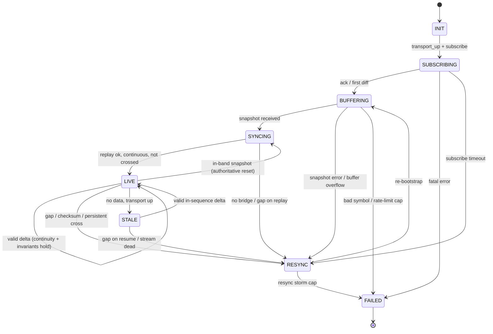

# Orderbook Lifecycle — Finite State Machine

Scope: the **orderbook synchronization lifecycle only**. The WebSocket *connection*
lifecycle is specced separately; this machine treats the transport as a dependency
that emits three events — `transport_up`, `book_message(raw)`, `transport_down` —
and exposes one signal the arbitrage engine cares about: a conservative `tradeable`
gate.

One machine instance per `(venue, symbol)`.

---

## Cardinal rule

> `tradeable` is `false` in **every** state except `LIVE`, and within `LIVE` it is
> gated **per-message** on validation passing. A book in any doubt is dropped from
> the arb signal — never published stale.

This is the direct expression of *correctness > latency*. A silently stale or
desynced book produces phantom arbitrage signals and bad fills; it is strictly
worse than an absent book.

---

## The two snapshot-acquisition models

Both are covered by the same states; only the snapshot *source* differs.

| Model | Venues | Snapshot source | Resync cost |
|---|---|---|---|
| REST-snapshot | Binance spot & USDⓈ-M futures | separate REST `GET` depth call | high (REST weight) |
| In-band-snapshot | Bybit v5, OKX `books`, Bitget | WS pushes `snapshot` then `delta`/`update` | low (resubscribe only) |

`BUFFERING` = "acquiring the snapshot while queueing diffs" in both models. In-band
venues can also re-push a snapshot mid-stream after a backend restart — this is a
**normal authoritative reset**, not an error (see transition 12).

---

## State diagram

> Any non-terminal state also transitions to `INIT` on `transport_down`
> (omitted above for readability — see transition 18).

---

## States — purpose, entry/exit actions, tradeable

### INIT
- **Purpose:** book object exists, nothing subscribed.
- **Entry:** allocate book; zero all sequence trackers (`last_update_id`, `prev_u`,
  `prev_seq`, `checksum`); clear diff buffer; `tradeable = false`.
- **Exit:** none.
- **Tradeable:** no.

### SUBSCRIBING
- **Purpose:** subscribe frame sent, awaiting confirmation.
- **Entry:** send subscribe; **start buffering every inbound book message
  immediately** (not after the ack — diffs commonly arrive interleaved with or
  before the ack; the gap between "subscribed" and "started buffering" is the
  classic desync bug); arm subscribe-timeout.
- **Exit:** disarm subscribe-timeout.
- **Tradeable:** no.

### BUFFERING
- **Purpose:** subscribed; accumulating diffs in an ordered, bounded queue while the
  snapshot is fetched (REST) or awaited (in-band).
- **Entry:** REST venues — enqueue a rate-limited snapshot fetch; in-band — keep
  buffering. Arm snapshot-timeout and buffer-overflow guard.
- **Exit:** disarm both.
- **Tradeable:** no.

### SYNCING
- **Purpose:** snapshot in hand; build the book and replay the buffer through the
  venue alignment rule.
- **Entry:** construct book from snapshot levels; replay buffered diffs applying the
  discard / bridge / continuity rules.
- **Exit:** clear the buffer.
- **Tradeable:** no — published only after the transition to `LIVE` completes.

### LIVE
- **Purpose:** synchronized; applying live deltas and validating each.
- **Entry:** `tradeable = true`; reset staleness timer; emit `book_ready`.
- **Per-message:** validate → apply → post-check.
- **Exit:** `tradeable = false` **first, always**, before anything else runs.
- **Tradeable:** yes.

### RESYNC
- **Purpose:** recoverable desync; tear down and re-bootstrap. The hub every
  recoverable fault funnels through.
- **Entry:** `tradeable = false`; clear book + buffer; reset trackers; increment a
  windowed resync counter; apply backoff.
- **Exit:** none.
- **Tradeable:** no.

### STALE
- **Purpose:** no updates within the staleness budget, but transport still up and
  sequence not yet known-broken.
- **Entry:** `tradeable = false`; **retain the book** (it may still be correct);
  start an active liveness probe.
- **Exit:** none.
- **Tradeable:** no.

### FAILED
- **Purpose:** unrecoverable for now — bad/delisted symbol, auth/permission error,
  or resync-storm cap hit.
- **Entry:** `tradeable = false`; long backoff; alert/metric; drop from active set
  if permanent.
- **Exit:** none.
- **Tradeable:** no.

*(`CLOSING`/`CLOSED` is the orderly-unsubscribe path on shutdown — trivial, omitted.)*

---

## Transition table — trigger / guard / action

| # | From → To | Trigger | Guard | Action |
|---|---|---|---|---|
| 1 | INIT → SUBSCRIBING | `transport_up` + subscribe requested | transport connected | send subscribe; begin buffering; arm subscribe-timeout |
| 2 | SUBSCRIBING → BUFFERING | subscribe ack, or first diff seen | — | (REST) enqueue snapshot fetch; arm snapshot-timeout + overflow guard |
| 3 | SUBSCRIBING → FAILED | error response | error ∈ {bad symbol, no permission, delisted} | mark permanent; no retry |
| 4 | SUBSCRIBING → RESYNC | subscribe-timeout fires | attempts < cap | backoff; retry subscribe |
| 5 | BUFFERING → SYNCING | snapshot received (REST or in-band) | — | build book; begin replay |
| 6 | BUFFERING → RESYNC | snapshot HTTP/timeout error, **or** buffer overflow | attempts < cap | drop buffer; backoff |
| 7 | BUFFERING → FAILED | snapshot 4xx (bad symbol), repeated 429 past cap | — | halt; long backoff |
| 8 | SYNCING → LIVE | replay completes, book continuous, checksum ok | book has both sides, not crossed | publish `book_ready`; reset staleness timer |
| 9 | SYNCING → RESYNC | snapshot doesn't bridge buffer, or gap during replay | — | discard; re-bootstrap |
| 10 | LIVE → LIVE | valid delta | sequence continuous **and** post-apply invariants hold | apply; reset staleness timer |
| 11 | LIVE → RESYNC | sequence gap, checksum mismatch, or persistent crossed book | — | tear down book; re-bootstrap |
| 12 | LIVE → SYNCING | in-band `snapshot` message arrives | venue supports mid-stream snapshot | rebuild from snapshot (authoritative, **not** an error) |
| 13 | LIVE → STALE | staleness timer fires | transport still up | start liveness probe |
| 14 | STALE → LIVE | valid in-sequence delta arrives | continuity holds | resume; reset timer |
| 15 | STALE → RESYNC | delta arrives with a gap, or probe shows venue alive but stream dead | — | re-bootstrap |
| 16 | RESYNC → BUFFERING | re-bootstrap begins | resync count in window < cap | (in-band) unsubscribe+resubscribe to force fresh snapshot; (REST) re-buffer + new snapshot |
| 17 | RESYNC → FAILED | resync count in window ≥ cap | — | halt; alert; long backoff |
| 18 | any non-terminal → INIT | `transport_down` | — | `tradeable = false`; discard book; await `transport_up` |

Transition 18 is the bridge to the transport FSM: a socket drop instantly
invalidates every book on it; reconnection re-enters at `INIT`. Transition 12 is the
one people forget — Bybit/OKX push a fresh snapshot unprompted after a backend
restart, and treating that as a desync rather than an authoritative reset causes
needless thrash.

---

## Invariants — detection + recovery

**Validation order matters:** check continuity *before* applying (so a bad event
never corrupts the book), then apply, then run post-apply checks. Each violation
routes to `RESYNC` unless noted.

### 1. Sequence continuity (primary detector)
Venue-specific. Verify exact field names against each venue's **current** docs
before shipping — these are the semantics, but exchanges version their payloads.

- **Binance spot:** in `SYNCING`, discard buffered events where `u ≤ last_update_id`;
  the first applied event must satisfy `U ≤ last_update_id+1 ≤ u`; thereafter every
  event needs `U == prev_u + 1`. No bridging event in the buffer ⇒ snapshot too old
  ⇒ `RESYNC`.
- **Binance USDⓈ-M futures:** first event `U ≤ last_update_id ≤ u`; continuity is
  `pu == prev_u`.
- **OKX:** `prevSeqId == prev_seqId`; a `seqId` reset to a smaller value signals a
  new snapshot epoch.
- **Bybit v5:** monotonic `u`/`seq`; any backward or skipped id ⇒ resubscribe.

*Detection:* per-message comparison against the tracker. *Recovery:* `RESYNC`.

### 2. No crossed book
Checked **only at event boundaries** (mid-event the book may transiently cross).
`best_bid_price ≥ best_ask_price` after a fully-applied event ⇒ missed delete or
desync ⇒ `RESYNC`. Do not trip on a single mid-event reading.

### 3. Checksum (OKX/Bitget: CRC32 over top 25 levels)
Cheapest, strongest desync detector available — run it **every message** it is
provided, not periodically. Mismatch ⇒ `RESYNC`. Venues without a checksum rely
solely on continuity, which is a reason to trust them less.

### 4. Monotonic update id / timestamp
Reject out-of-order or duplicate events **silently** (Binance re-delivers on
reconnect — drop, don't resync). A *backward* jump that isn't a known snapshot epoch
⇒ `RESYNC`.

### 5. Snapshot freshness
The snapshot must bridge to the buffer (covered by #1). If the entire buffer is
newer than the snapshot with a gap between, the snapshot landed too late ⇒ `RESYNC`;
if recurrent, the REST snapshot is too slow (a scale problem — see below).

### 6. Level sanity
Non-negative size, positive price, size within sane bounds; zero size = delete that
level. Garbage values usually mean a parse/desync bug ⇒ `RESYNC` (log loudly;
repeated sanity failures on one symbol may indicate a venue payload change ⇒
`FAILED`).

### 7. Bounded staleness ≠ desync
The subtle one. A thin market legitimately produces no updates for seconds; *no data*
is not *bad data*. **Do not drive staleness off a fixed per-symbol timer alone** — a
quiet altcoin will false-positive constantly. Drive hard liveness off the
connection-level heartbeat (transport FSM); treat book-level staleness as a *soft*
quarantine: enter `STALE`, run a liveness probe (is the venue sending anything on
this socket? is a top-of-book/ticker channel still ticking?), and only escalate to
`RESYNC` if the stream is provably dead while the venue is alive. A correct-but-quiet
book in `STALE` simply isn't published until it ticks again.

---

## Failure catalog — recovery for each

| Failure | Recovery |
|---|---|
| Subscribe ack never comes | `SUBSCRIBING` timeout → `RESYNC` (backoff); past cap → `FAILED` |
| Bad/delisted symbol, no permission | `FAILED`, permanent, removed from active set — never retry blindly (burns rate limit) |
| Snapshot fetch fails (timeout / 5xx / 429) | `RESYNC` with backoff; sustained 429 → `FAILED` + backoff rather than hammering |
| Buffer overflows before snapshot arrives | `RESYNC` — cannot drop from the middle of a diff stream, so abandon and re-bootstrap; persistent overflow = snapshot too slow |
| Snapshot doesn't bridge the buffer | `RESYNC` |
| Sequence gap / checksum mismatch / persistent cross in `LIVE` | `RESYNC` |
| Mid-stream snapshot (in-band venues) | `SYNCING` → rebuild → `LIVE`; **not a failure** |
| Stream silent, transport up | `STALE`; probe; resume or `RESYNC` |
| Transport down | `INIT` (transition 18); re-bootstrap on reconnect |
| Resync storm (N resyncs in rolling window) | `FAILED` with long backoff — prevents one symbol spinning REST snapshots forever |

---

## Scale notes — 15 venues × ~2000 markets, single host, low-ms budget

The snapshot dependency dominates everything at this scale.

- **REST snapshots are the bottleneck and the biggest correctness risk on
  reconnect.** When a Binance socket drops, every book on it re-enters `INIT` and
  wants a snapshot simultaneously. You cannot fire ~2000 REST snapshots at once —
  Binance depth snapshots are weight-expensive. Put a token-bucket / weighted limiter
  in front of `BUFFERING`'s fetch step. The
  buffer-overflow guard exists precisely because snapshots queue behind this limiter.
- **In-band-snapshot venues (Bybit/OKX/Bitget) are dramatically friendlier** — a
  `RESYNC` is just an unsubscribe/resubscribe over the existing socket, zero REST
  cost. *Opinionated take:* where a venue offers a checksummed in-band depth channel,
  prefer it; resync cost and desync-detection quality are both better than Binance's
  REST-snapshot model.
- **Make the FSM allocation-free in `LIVE`.** Per-message validation and apply are
  the hot path for the low-ms budget; pre-size the book structure, avoid per-tick
  allocation, keep the per-symbol machine lock-free.
- **Cap resyncs globally and per-symbol.** A resync storm across many symbols at once
  (e.g. after a venue hiccup) is exactly when the rate limit blows; the windowed
  counter + `FAILED` backoff keeps a venue blip from cascading.

## Which venue timestamp field feeds which signal
 
Most venues publish more than one time, and they mean different things. This is where teams silently get it wrong.
 
| Venue / channel | Send time | Engine (event) time | Sequencing | Correct field for content-freshness |
|---|---|---|---|---|
| **Binance spot** (`@depth`) | `E` | — (not published) | `U`, `u` | `E` (degrades to send-time) |
| **Binance USDⓈ-M futures** (diff depth) | `E` | `T` (matching engine; `T` precedes `E`) | `U`, `u`, `pu` | **`T`** |
| **Bybit v5** (`orderbook.*`) | `ts` | `cts` (matching engine; correlates with trade-feed `T`) | `u`, `seq` | **`cts`** |
| **OKX** (`books`) | `ts` | — (none on this channel) | `seqId`, `prevSeqId` | `ts` (degrades to send-time) |
| **Bitget** (depth) | `ts` | — (none) | `seq` | `ts` (degrades to send-time) |