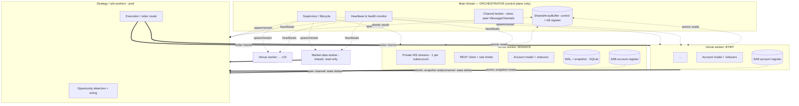
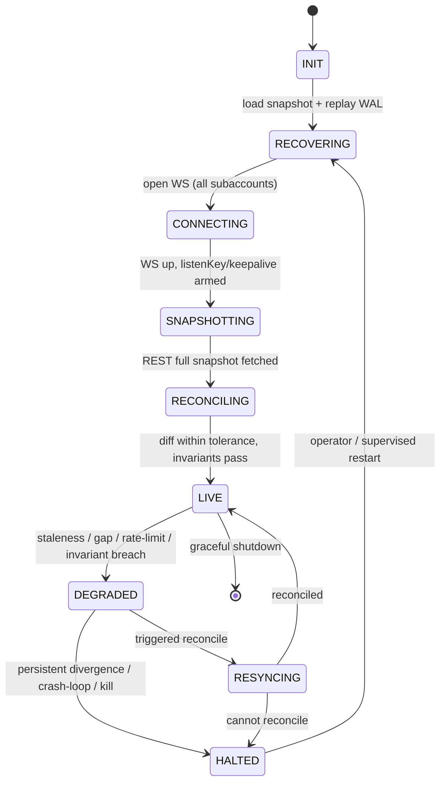

# Reliable Local Account State — Architecture, Orchestration, Reliability & Kill-Switches

**Scope:** CEX–CEX price arbitrage (spot-spot, spot-perp, perp-perp) across ~15 venues, multiple subaccounts each, market types spot / linear / unified-margin. Single host, single region, Node.js + TypeScript, `worker_threads` spawned from one orchestrator process. Local account state (balances, orders, fills, positions, funding, fees) must be continuously correct, survive restarts, and gate execution.

**The one principle everything below serves:** *the venue is the only source of truth; local state is a cache that is allowed to be fast but never allowed to be silently wrong.* When correctness and latency conflict, correctness wins — and "wrong" must always be loud (degrade + halt), never quiet.

This document covers four dimensions only: **(15) Architecture / topology / decomposition, (16) Orchestration, (14) Reliability & failure handling, (12) Circuit breakers, protections & kill-switches.**

---

## 0. Opinionated TL;DR

- **Shard by venue.** One `worker_thread` per venue owns *everything* for that venue: private WS streams (one per subaccount), REST client, rate limiter, and the authoritative account model for its subaccounts. Event → state mutation happens **in-thread, zero IPC, zero serialization** on the hot path.
- **The main thread is a pure supervisor.** It holds no business state and is never on the data path. It spawns workers, wires *peer-to-peer* `MessageChannel`s between them, monitors heartbeats, and owns restart policy.
- **Hot reads cross threads via a `SharedArrayBuffer` "account register" using a seqlock**, not message passing. Strategy workers read free-collateral / position-qty with `Atomics`, lock-free, in nanoseconds. Rich state (open-order maps) is pushed on-change via the peer channel.
- **Money is never a float.** Scaled `bigint` (or decimal) everywhere. Equality uses exact integer math; reconciliation uses an explicit dust epsilon only at the venue boundary.
- **State is event-sourced into a per-venue WAL + periodic snapshot** (SQLite in WAL mode via `better-sqlite3`, synchronous, inside the venue worker). Restart = load snapshot → replay WAL tail → REST resync → reconcile → only then go LIVE.
- **Trading is gated on a freshness + reconciliation contract.** A venue is tradeable only while `LIVE ∧ reconciled ∧ (now − lastEvent) < stalenessBudget`. Anything else trips a breaker and halts that venue.
- **Two independent kill layers:** a local `SharedArrayBuffer` control register checked on every order-send path, and **venue-side dead-man's switches** (Bybit DCP, Binance countdown-cancel-all, etc.) so resting orders die even if our process is the thing that died.

---

## 15. Architecture, Process Topology & System Decomposition

### 15.1 Topology



### 15.2 Why this decomposition

**Shard key = venue (then subaccount within the venue worker).** This is the decision that makes the system both performant and correct:

- **Correctness:** account state is a *per-venue consistency domain*. A balance, an order, and a fill on Binance only ever interact with each other. There is no cross-venue transaction that needs a single lock, so there is no reason to centralize state and pay coordination cost. Each venue worker is a self-contained, single-writer consistency boundary — the simplest possible model to reason about.
- **Isolation:** a flaky WS on one venue, a CPU spike from a burst of fills, a GC pause, or a crash is contained to that venue's thread. The other 14 keep trading. (Failure blast radius = one venue.)
- **Hot-path performance:** the latency-critical sequence is *event-in → reduce → register-write*. By co-locating the WS parser, the reducer, and the account model in **one thread**, that sequence has **no IPC hop and no structured-clone serialization**. The event lands on the socket and mutates an in-thread object directly.
- **Scale/maintain/extend:** adding venue #16 is "spawn one more identical worker." Each venue's quirks (Binance `listenKey` keepalive, Bybit unified account, OKX account modes) live behind one normalization adapter inside one worker, not smeared across a shared engine.

### 15.3 Thread roles (concrete)

| Thread | Count | Owns | On hot path? |
|---|---|---|---|
| **Orchestrator** (main) | 1 | spawn/restart, heartbeats, channel wiring, control/kill register, config & secrets, time-sync monitor | **No** (control plane only) |
| **Venue worker** | 1 per venue (~15) | private WS (per subaccount), REST + rate limiter, normalization adapter, **authoritative account model**, reducers, WAL+snapshot, per-venue SAB register | **Yes** (event→state) |
| **Strategy/arb worker** | small pool (CPU-bound sizing) | opportunity detection, sizing against account register, risk pre-checks | **Yes** (read) |
| **Execution worker** | 1 or folded into strategy | order intent → idempotent send via venue worker, ack/timeout tracking | **Yes** |
| **Market-data worker** | 1+ | public books/trades, normalization, fan-out | Yes (separate consistency domain — out of scope here) |

Keep the orchestrator off the data path entirely. The classic anti-pattern is routing all inter-worker traffic through the main thread; it becomes the bottleneck and a single point of failure. Instead the orchestrator only *brokers* channels (see 16.2) and the workers talk **peer-to-peer**.

### 15.4 Cross-thread state sharing — two tiers

**Tier 1 — Hot numeric register (`SharedArrayBuffer` + seqlock).** The small set of values the arb loop reads on every decision (free collateral per asset, available balance, position qty/entry per symbol, a per-venue `tradeable` flag) live in a `SharedArrayBuffer` struct, **written only by the owning venue worker, read lock-free by any strategy worker** using a seqlock:

```ts
// Writer (venue worker), single writer guaranteed by sharding:
Atomics.store(seq, i, seq[i] + 1);        // make odd → "write in progress"
Atomics.store(view, FREE_COLLATERAL, v);  // write fields...
Atomics.store(view, POSITION_QTY, q);
Atomics.store(seq, i, seq[i] + 1);        // make even → "stable"

// Reader (strategy worker), retries on a torn read:
let s1, s2, free, qty;
do {
  s1 = Atomics.load(seq, i);
  if (s1 & 1) continue;          // writer mid-write
  free = Atomics.load(view, FREE_COLLATERAL);
  qty  = Atomics.load(view, POSITION_QTY);
  s2 = Atomics.load(seq, i);
} while (s1 !== s2 || (s1 & 1));  // value set was consistent
```

This gives consistent, **wait-free** reads of a coherent snapshot with no message-passing latency and no locks — the right tool for "size against free capital on every tick."

**Tier 2 — Rich state deltas (message passing).** Full open-order maps, per-order lifecycle, fill ledgers, funding history are pushed **on change** over the peer `MessageChannel` as compact deltas (ideally a flat binary/transferable, not deep object graphs). Strategy workers keep a local read-replica. These are not on the size-every-tick path, so the serialization cost is acceptable.

> **Never** put balances/positions in `localStorage`-style shared mutable JS objects across threads or rely on message ordering for correctness of the hot register — the seqlock contract is what makes a cross-thread read *coherent*.

### 15.5 The account model: canonical events + reducers (event-sourcing-lite)

Each venue worker normalizes venue-specific payloads into a **canonical event union**, then applies them through pure, **idempotent** reducers to an in-memory model. This is the backbone of both correctness and recoverability.

```ts
type AccountEvent =
  | { k: 'OrderAccepted';  venueOrderId: string; clientId: string; ... }
  | { k: 'OrderPartiallyFilled'; clientId: string; tradeId: string; qty; price; fee; ... }
  | { k: 'OrderFilled';   ... }
  | { k: 'OrderCanceled' | 'OrderRejected' | 'OrderExpired'; ... }
  | { k: 'BalanceDelta';  asset: string; available: bigint; locked: bigint; ... }
  | { k: 'PositionUpdate'; symbol; qty: bigint; entry: bigint; ... }
  | { k: 'FundingAccrued' | 'FundingSettled'; symbol; amount: bigint; ts; ... }
  | { k: 'FeeCharged'; ... }
  | { k: 'ReconcileSnapshot'; source: 'REST'; ... };   // truth injection
```

Key properties:

- **Idempotent application.** Every event carries a stable id (`tradeId`, `venueOrderId`+`status`, funding `id`). The reducer keeps a dedup set / last-applied-seq so duplicate or replayed events are no-ops. At-least-once delivery + idempotent reducers = **effectively-once**.
- **Derived balances via an internal ledger.** Model `available = total − Σ(open-order reservations) − Σ(unsettled)` as a derived quantity from postings (reservation on accept, release on fill/cancel, debit on fee/funding). This makes the local view *auditable* and lets you assert invariants (15.6). You still store the venue's *reported* numbers alongside — reconciliation diffs derived-local vs. venue-reported.
- **Money as scaled `bigint`.** Pick per-asset scale from venue tick/step metadata; store integer minor units. No float arithmetic anywhere in the ledger. Reconciliation tolerance (dust) is the *only* place an epsilon appears, and only at the venue boundary.

### 15.6 Continuous invariants (asserted in-thread, cheap)

After every reduce, assert (cheap integer checks):

- `available + locked == total` per asset.
- `Σ reservation(open orders) == locked` (within venue's margin model).
- No negative `available`; no position direction flip without a corresponding fill sequence.
- Unified/cross-margin: collateral equation consistent with venue's margin tier.

An invariant breach is treated as **silent divergence detected** → degrade venue → force REST resync → if it persists, halt + alert (see 14 & 12). Invariants are your early-warning system for "local is wrong" *before* the periodic reconcile would catch it.

### 15.7 Layered decomposition inside a venue worker

```
Transport     WS sockets (per subaccount) + REST + auth + rate limiter + backoff
   │
Normalize     venue payload → canonical AccountEvent  (the only venue-specific layer)
   │
Sequence      gap detection (update-id/seq), reorder buffer, dedup
   │
Reduce        pure reducers → in-memory account model + invariants
   │
Persist       append to WAL (fsync, checksummed) → periodic snapshot
   │
Publish       Tier-1 register write (seqlock) + Tier-2 delta to strategy channel
   │
Reconcile     periodic + triggered REST snapshot → diff → correct (truth wins)
```

Each layer is independently testable; the only venue-coupled code is **Normalize** (and the venue's reconcile field mapping). Everything downstream is generic — this is what makes 15 venues maintainable.

---

## 16. Orchestration

### 16.1 Orchestrator responsibilities (and non-responsibilities)

The main thread is a **supervisor**, modeled on Erlang/OTP supervision trees. It does:

1. **Bootstrap** — load config + secrets, validate, allocate the shared control register and per-venue registers (`SharedArrayBuffer`s), then spawn workers in dependency order (registers → venue workers → market-data → strategy).
2. **Readiness handshake** — each worker reports `READY` only after it has reached a reconciled LIVE state; the orchestrator holds the global trading gate closed until required workers are READY.
3. **Health monitoring** — heartbeats + liveness (see 16.5).
4. **Channel brokering** — create `MessageChannel`s and hand each end (transferable `MessagePort`) to the two peers so they talk directly (16.2).
5. **Restart policy** — supervised restart with backoff + crash-loop breaker (16.6).
6. **Graceful shutdown** — drain → cancel/flatten per policy → flush WAL → snapshot → exit (16.7).
7. **Time-sync monitoring** — track local-vs-venue clock skew; trip a breaker on drift (16.8).
8. **Own the kill register** — set global/per-venue kill flags atomically (see 12).

It does **not** hold balances, route fills, or sit on any data path.

### 16.2 Peer-to-peer channel wiring (avoid the main-thread bottleneck)

```ts
// In orchestrator, wire venue<->strategy directly:
const { port1, port2 } = new MessageChannel();
venueWorker.postMessage({ t: 'attachStrategyPort', port: port1 }, [port1]);   // transfer
stratWorker.postMessage({ t: 'attachVenuePort', venue, port: port2 }, [port2]);
```

After wiring, account deltas and order intents flow venue ↔ strategy **without** transiting the main thread. The orchestrator only carries control messages (config, kill, shutdown, heartbeat acks). This keeps the supervisor responsive even under peak trading load — critical, because a blocked supervisor can't fire a kill-switch.

### 16.3 Venue worker state machine



**Only `LIVE` is tradeable.** `DEGRADED`/`RESYNCING`/`HALTED` immediately flip the venue's `tradeable` bit in the SAB register to 0, so strategy workers stop sizing against that venue on their very next read — no message needs to arrive in time.

### 16.4 Cold-start / restart sequence (the survival path)

On process start (or any venue worker (re)start):

1. **Recover** — open the venue's SQLite store, load the latest consistent **snapshot**, then **replay the WAL tail** (records after the snapshot, each checksum-verified) to rebuild the in-memory model. Now local state = "what we believed at crash time."
2. **Reconnect** WS (all subaccounts), arm keepalives (`listenKey` refresh, ping/pong), subscribe to the disconnect-protect topic if the venue requires it for DCP (see 12).
3. **REST snapshot** — pull balances, open orders, positions, and recent fills/funding via REST. This is **ground truth**.
4. **Reconcile** — diff recovered-local vs. REST truth; correct local to truth, log every discrepancy to the discrepancy ledger.
5. **Gate open** — only now flip `tradeable = 1` and report `READY`. The global trading gate opens when all required venues are READY.

The persisted state's job is *not* to be authoritative — it's to (a) preserve in-flight order context (client IDs, pending acks) across a restart so you don't double-send, and (b) let you reconcile *against* truth rather than starting blind.

### 16.5 Health monitoring & liveness

- **Heartbeats:** each worker posts a heartbeat (monotonic seq + `lastEventTs` per stream) to the orchestrator every N×100ms.
- **Liveness vs. readiness:** a worker can be *alive* (heartbeating) but *not tradeable* (DEGRADED). Track both. A missed heartbeat for > threshold ⇒ presumed hung ⇒ fire venue-local cancel/flatten policy, then restart the worker.
- **Watchdog inside each worker too:** an in-thread staleness watchdog checks `now − lastEventTs` per stream; a blocked event loop won't update it, which the orchestrator detects as a missed heartbeat — defense in depth against a silently stalled thread.

### 16.6 Supervision & restart strategy

Borrow OTP semantics, per concern:

- **One-for-one (default):** a crashed venue worker restarts independently; the other 14 are untouched. State recovers from WAL+snapshot+REST (16.4).
- **Crash-loop breaker:** > K restarts in window T ⇒ stop restarting that venue, leave it HALTED, page a human. A worker that keeps dying is more dangerous restarted than dark.
- **Rest-for-one / one-for-all:** reserve for shared-dependency failures (e.g., the SAB allocator) — rare here because venues are independent.
- **Never auto-restart into trading.** Restart always re-runs the full reconcile gate before `tradeable` is set.

### 16.7 Graceful shutdown / drain

On SIGTERM/operator stop:

1. Flip global gate closed; stop accepting new arb intents.
2. Per venue, execute the **shutdown order policy**: cancel resting orders (and flatten if policy = flat-on-stop), confirm via REST.
3. Wait for in-flight acks/fills to settle or time out; resolve unknowns via reconcile.
4. `fsync` WAL, write a final snapshot, mark clean-shutdown flag.
5. Tear down channels, exit. (Clean-shutdown flag lets next start skip the "was this a crash?" heuristic.)

### 16.8 Time discipline

Single host helps (one clock), but venue clocks still matter:

- Monitor **local-vs-venue skew** from REST `serverTime` / response timestamps. Many venues reject requests outside a `recvWindow`; drift silently breaks order entry and signatures.
- Trip a breaker on drift beyond threshold; keep host NTP/chrony disciplined. Funding settlement, contract expiry, and rate-limit windows are all time-anchored — skew corrupts funding accrual math and can cause spurious reconciliation diffs.

---

## 14. Reliability, Failure Modes & Failure Handling

### 14.1 Core reliability principles

1. **Exchange is truth; local is a reconciled cache.** Every correction goes one way: truth → local.
2. **Idempotency everywhere.** Client-generated `clientOrderId` on every order; idempotent reducers keyed by stable event ids. Never blind-retry a mutating action.
3. **At-least-once + idempotent = effectively-once.** Design for duplicates and gaps as the *normal* case.
4. **Loud-on-wrong.** A detected divergence must degrade + halt + alert. Silent staleness is the catastrophic failure; make it impossible to be silent.
5. **Integer money.** Already stated, repeated because float drift *is* a divergence source.
6. **Single writer per consistency domain.** The venue worker is the only writer of its account state; enforce a single-process file/advisory lock on the data dir to prevent split-brain from a second instance.

### 14.2 Failure-mode catalog & handling

| # | Failure mode | Detection | Handling |
|---|---|---|---|
| 1 | **Lost order ack** (sent, no response) | send timeout; no terminal event | **Never blind-retry.** Resolve by `clientOrderId` via REST (`GET order`). If exists → adopt its state; if not → safe to resend with same id. Reservation held until resolved. |
| 2 | **Fill arrives before order ack** (race) | event references unknown `clientId` | Create a **provisional order** from the fill (we know we sent it; the id is ours) and reconcile when the accept event/REST confirms. |
| 3 | **Dropped WS messages / gap** | update-id / sequence discontinuity | Buffer, request gap fill if supported, else **triggered REST resync** for the affected stream; do not apply past the gap. |
| 4 | **Out-of-order events** | non-monotonic seq/ts | Reorder buffer keyed by seq; apply only monotonically; stale updates ignored. |
| 5 | **Duplicate events** | dedup set / last-applied-seq | No-op (idempotent reducer). |
| 6 | **WS disconnect / `listenKey` expiry** | ping/pong miss; keepalive lapse; silent stream death | Reconnect → re-snapshot → reconcile → gap-check buffered events. Arm `listenKey` keepalive (Binance ~30–60 min) and ping/pong watchdogs so expiry can't be silent. |
| 7 | **Staleness / silent divergence** | per-stream `now − lastEventTs` watchdog; invariant breach | DEGRADED → flip `tradeable=0` → triggered resync. Trading on that venue stops *before* any decision uses stale data. |
| 8 | **Clock skew** | serverTime delta | Breaker; resync NTP; reject sends while skewed. |
| 9 | **Rate-limit / ban** (429/418/IP ban) | weight accounting + response codes | Token-bucket limiter with venue weight model; exponential backoff; losing REST means losing reconcile ability → DEGRADE (can't verify truth = not tradeable). |
| 10 | **Reconciliation conflict** (local ≠ truth) | periodic/triggered REST diff | Truth wins: snap local to venue, log to discrepancy ledger, alert. **Confirm-twice** before forcing (debounce transient venue snapshots — e.g., momentarily unsettled balances). |
| 11 | **Funding settlement** (balance moves with no trade) | funding event / income endpoint | Model `FundingAccrued` (running, informational) + `FundingSettled` (balance posting); reconcile against the venue's funding/income history, not just trade fills. |
| 12 | **Process crash** | restart | Recover from snapshot + WAL replay → REST resync → reconcile (16.4). Checksummed WAL records survive torn writes. |
| 13 | **Crash loop** | restart counter | Supervisor breaker: stop restarting, stay HALTED, page human (16.6). |
| 14 | **Split-brain** (2nd instance) | data-dir lock contention | Single-writer advisory/file lock; second instance refuses to start. |
| 15 | **unified-margin math errors** | invariant breach; reconcile diff | Per-market-type contract math in the normalization adapter, covered by golden tests against known REST snapshots. |

### 14.3 Reconciliation engine (the heart of correctness)

Three concurrent mechanisms:

- **Continuous invariant checks** (15.6) — in-thread, every reduce, microsecond cost. First line of "local looks wrong."
- **Triggered reconciliation** — fired on (re)connect, gap, ack-timeout, invariant breach, or suspicious delta. Pulls REST truth for the affected scope and diffs.
- **Periodic reconciliation** — every N seconds (balances/positions/open orders) and a slower sweep for fills/funding. Full diff vs. local within per-asset dust tolerance.

Conflict resolution rules:

- **Truth always wins**, but **confirm-twice before correcting** to avoid reacting to a transient venue read (an unsettled fill, an eventually-consistent balance endpoint). Two independent reads agreeing → correct.
- **Every correction is logged** to a durable *discrepancy ledger* (timestamp, field, local, venue, delta, suspected cause). Recurrent discrepancies on one field/venue are a bug signal, not noise to swallow.
- A correction beyond a *material* threshold doesn't just fix state — it **trips the divergence breaker** (12) and halts the venue pending review, because a large unexplained diff means our event handling is broken, and the next one might not be caught.

### 14.4 Persistence & recovery

- **WAL:** append-only, `fsync` on commit, **per-record checksum** (torn-write protection), monotonically sequenced. Every applied event/posting is a WAL record before it's acknowledged as durable.
- **Snapshots:** periodic consistent point-in-time dump of the account model; truncate WAL behind it. Snapshot + WAL tail = O(seconds) recovery.
- **Engine:** **SQLite in WAL journal mode via `better-sqlite3`** — synchronous API fits a worker thread perfectly (no event-loop juggling), ACID, battle-tested, single-file, survives restart. Reach for **LMDB** (memory-mapped, ACID, very high write throughput) only if a hot venue's posting rate outruns SQLite. Keep one store **per venue worker** so there's no cross-thread DB contention.
- **Recovery is always followed by REST reconcile** — persisted state is a head start, never the final authority (16.4).

### 14.5 Observability for correctness (not just ops)

Treat these as first-class, alertable signals:

- **State lag** per stream (`now − lastEventTs`), reconnect counts, gap counts.
- **Reconciliation diff** magnitude/frequency per venue/field (the canary).
- **Discrepancy ledger** growth rate and recurring fields.
- **Ack latency** and **unknown-order count** (acks unresolved past budget).
- **Invariant-breach counter** (should be ~0; any nonzero is investigated).
- Structured logs keyed by `(venue, subaccount, clientOrderId)` for replay/debug.

---

## 12. Circuit Breakers, Protections & Kill-Switches

Defense in depth: **pre-trade gates → per-concern breakers → local global kill → venue-side dead-man's switch.** No single layer is trusted alone.

### 12.1 The control / kill register (`SharedArrayBuffer`)

The orchestrator owns a small `SharedArrayBuffer` "control register" with atomic flags: a **global trading flag**, a **per-venue tradeable flag**, and **halt-level** per venue. Properties:

- **Written** by orchestrator (global/operator) and by each venue worker (its own venue flag, e.g. on DEGRADED).
- **Read on every order-send path** via `Atomics.load` — nanoseconds, no message latency. A kill takes effect on the *next order attempt across all threads* the instant the flag flips; no message needs to be delivered in time.
- This is why the orchestrator must never block (16.2): the kill path must always be live.

### 12.2 Pre-trade gates (sizing-time)

Before any order is sized or sent, the strategy/execution worker requires **all** of:

- Global trading flag = ON; venue `tradeable` = 1 (i.e. venue `LIVE`).
- **Freshness:** `now − lastEventTs(venue) < stalenessBudget` (read from register).
- **Reconciled:** last reconcile within budget and within tolerance.
- **Exposure room:** order keeps venue/asset/gross/net within configured limits.

Fail any check ⇒ **no trade** (and, for freshness/reconcile failures, the venue is already DEGRADED). Sizing against capital you can't currently verify is the exact catastrophe this system exists to prevent.

### 12.3 Per-concern circuit breakers

Each runs an independent `CLOSED → OPEN → HALF_OPEN → CLOSED` machine:

| Breaker | Trips on | Action when OPEN | Probe (HALF_OPEN) |
|---|---|---|---|
| **Staleness** | event lag > budget | venue → DEGRADED, `tradeable=0`, optional cancel resting | first fresh event / successful resync |
| **Divergence** | reconcile diff > material threshold | halt venue, force resync, alert | clean reconcile ×2 |
| **Connection** | reconnect/error rate > N in window | backoff, hold venue dark | stable connection for T |
| **Rate-limit** | approaching venue weight cap | throttle/pause sends | window resets under cap |
| **Invariant** | any invariant breach | DEGRADED + resync; persistent → HALT | invariants pass post-resync |
| **Loss/drawdown** | daily PnL / drawdown limit hit | block new entries (allow closing) | manual or next session |

Breakers fail **closed** (toward not-trading). HALF_OPEN always re-runs the reconcile gate before re-enabling.

### 12.4 Global kill-switch (local)

- **Automated triggers:** crash loop, time-skew breach, simultaneous multi-venue divergence, loss-limit breach, "impossible state" (negative available, position flip without fills).
- **Manual:** operator command / OS signal sets the global flag; reachable even when the app is degraded because it's just an atomic store + a broadcast.
- **Tiered halt levels** (per venue and global):
  1. **SOFT** — no new entries; manage/close existing only.
  2. **HARD** — cancel all resting orders now (via REST `cancelAll`), confirm via reconcile.
  3. **FLATTEN** — cancel + close positions to flat.
  4. **FREEZE** — do nothing, human-only; used when state integrity itself is in doubt (don't trade *or* auto-cancel blindly when you can't trust your own view).

### 12.6 Exposure, position & loss limits

Enforced at the pre-trade gate and continuously:

- **Per-venue / per-asset / gross / net notional caps.** Breach blocks *opening*, always allows *closing*.
- **Per-strategy capital allocation** so one leg can't consume another's budget.
- **Daily loss / max-drawdown** → loss breaker → SOFT halt (close-only).
- **Anomaly detector** → impossible/implausible state → FREEZE + page (because if state is impossible, every downstream number is suspect).

---

## Appendix — Defaults cheat-sheet

| Concern | Default |
|---|---|
| Shard key | venue (subaccounts within venue worker) |
| Hot read | `SharedArrayBuffer` seqlock register |
| Rich state | on-change deltas over peer `MessageChannel` |
| Money type | scaled `bigint`, per-asset scale from venue metadata |
| Event model | canonical events → idempotent reducers + invariants |
| Durable store | per-venue SQLite (WAL mode, `better-sqlite3`), checksummed WAL + snapshots |
| Delivery model | at-least-once + idempotent = effectively-once |
| Order safety | client-generated `clientOrderId`; resolve-by-id on timeout, never blind-retry |
| Reconcile | continuous invariants + triggered + periodic; truth wins, confirm-twice |
| Tradeable contract | `LIVE ∧ reconciled ∧ fresh ∧ within-limits` |
| Kill layers | SAB control register (local) + venue dead-man's switch (remote) |
| Breaker policy | fail closed; HALF_OPEN re-runs reconcile gate |
| Restart policy | one-for-one + crash-loop breaker; never restart into trading |


### 16.6 Config, sharding & secrets

- **Shard assignment** (which venues/accounts map to which workers) is config-driven, enabling rebalancing without code changes as venue count grows.
- **Config distribution** flows orchestrator→workers at spawn; treat hot-reload conservatively — credential or endpoint changes generally warrant a supervised restart of the affected scope rather than in-place mutation of a live trading worker.
- **Secrets** (API keys) are injected per IO worker and **never logged**; signing happens inside the IO worker so keys don't traverse extra boundaries.


## 14. Reliability, Failure Modes & Failure Handling

This is where the system earns its keep. Below is the failure taxonomy, the handling for each, and the cross-cutting patterns that make handling uniform.

### 14.1 Failure-mode taxonomy

1. **Lost ack.** Order sent, no REST response (timeout). Did it land? **Never assume.** Every order carries a client-generated `clientOrderId`; on timeout, query the venue *by that id* to resolve. Until resolved, the order is `PENDING_UNKNOWN` and its worst-case exposure is reserved against capital.
2. **Dropped WS messages.** Detected via per-stream sequence / update-id **gaps** (§14.3). On a gap, trigger a targeted REST resync of the affected scope.
3. **WS disconnect / reconnect.** All events during the gap are lost. On reconnect, **always** full-REST-reconcile the scope before trusting the stream again, using snapshot+buffer+replay (§14.6). Never resume applying deltas blind.
4. **Out-of-order events.** A late REST snapshot or reordered delta overwrites newer data. **The single most important correctness rule:** every field carries a version/sequence, and an update applies *only if it is monotonically newer* — last-writer-wins by **sequence, not arrival time** (§14.3).
5. **Clock skew.** Wall clocks across sources are not trustworthy for ordering. Prefer venue-provided sequence numbers over timestamps everywhere ordering matters. Monitor host NTP; flag skew.
6. **Duplicate events (at-least-once delivery).** Idempotent application keyed by stable ids (`updateId`, `fillId`, `eventId`) with a dedup window. Replays and reconnect overlaps become no-ops.
7. **Fill/order race & partial fills.** A fill can arrive before the order-accepted event, or interleave across partials. The order state machine tolerates out-of-order arrival; an **orphan-fill buffer** holds fills whose parent order isn't seen yet, applied once it appears.
8. **Reconciliation divergence.** Periodic full snapshot disagrees with local. **Venue wins**, local is overwritten, and the event is alerted and classified — *transient* (timing, self-heals next cycle) vs *persistent* (recurs → systematic bug → trip the scope, §12).
9. **Funding settlement.** Funding fees hit the balance at settlement time; missing that event silently drifts the balance. Reconcile balances on a schedule aligned to each venue's funding windows, and after every settlement timestamp.
10. **Rate-limit bans (429 / 418).** A resync storm during an outage gets you banned, deepening the outage. A **shared per-venue token bucket** in the IO worker governs *all* REST callers (snapshots, order ops, queries); breach → venue REST breaker opens (§12.2) with backoff + jitter.
11. **Lying / stale venue data.** Rare but real (position shown after close, etc.). Caught by invariant cross-checks (§14.5), not assumed away.
12. **Persistence failures.** Disk full, `fsync` failure, WAL corruption. WAL mode + on-boot integrity check + replay; **fail-closed** — if the store is unhealthy, the system refuses to trade.
13. **Process restart mid-flight.** Orders in unknown state. Handled by the cold-start path (§16.3): rehydrate → full REST reconcile → resolve all `PENDING_UNKNOWN` by `clientOrderId` → only then READY.
14. **Numeric precision.** Floats silently corrupt money. Use integer minor units (`bigint`) or a decimal library (`decimal.js` / `dnum`); respect each venue's tick/lot/precision; carry values in smallest unit end-to-end (§14.4).
15. **Cross-margin coupling (unified margin).** One collateral pool backs many positions; a fill on symbol A changes free margin for symbol B. Model margin at the **account** level, derived from the venue's margin model and reconciled via the venue's margin/account-info REST endpoint — never compute available margin as a naive per-symbol sum.

### 14.2 Event sourcing + reconciliation loop (the backbone)

Two complementary mechanisms keep state correct:

- **Event sourcing** gives a deterministic, auditable derivation of state from a durable event log (§15.5). It answers "how did we get here?" and enables exact replay.
- **The reconciliation loop** is the safety net that assumes the event path *will* eventually lie or drop, and continuously checks local state against authoritative REST snapshots:
  - **Periodic, tiered:** balances & positions frequently; open orders frequently; trade history less often (audit). Each tier sized against the venue rate budget.
  - **Event-driven triggers:** immediately reconcile after any reconnect, any sequence gap, any funding settlement, any large fill, and any `PENDING_UNKNOWN` resolution.
  - **On mismatch:** venue wins → overwrite → alert → classify (§14.1 #8) → feed magnitude/frequency to the breakers (§12.2).

Event sourcing alone is not enough (it trusts the stream); reconciliation alone is not enough (it's coarse and laggy). Together they're robust.


### 14.4 Numeric discipline

- Balances/quantities/prices carried as integer minor units (`bigint`) or a decimal type — **never** IEEE-754 float.
- Per-venue, per-symbol precision metadata (tick size, lot size, min-notional) loaded from the adapter and enforced on read and on emit.
- Rounding rules are explicit and venue-correct; never let a rounding mismatch masquerade as divergence.

### 14.5 Invariants & assertions

The reconciler continuously asserts internal consistency; any violation alerts and is treated as untrusted state:

- `available + locked == total` per `(account, asset)`.
- Sum of reserved-on-open-orders == reported `locked`.
- Position reconstructed from the fill ledger == venue-reported position (within tolerance).
- Realized PnL from fills + funding + fees == observed balance delta over the window.

Invariant breaches are the earliest, cheapest divergence detector — they catch bugs the periodic reconcile would only find later.

### 14.6 The reconnect / resync algorithm (spell it out)

The same pattern used for order-book maintenance, applied to account state:

1. On (re)connect or gap, the IO worker **begins buffering** live WS deltas immediately, tagged with their sequence numbers.
2. Fetch the authoritative **REST snapshot**, which carries a snapshot sequence/time.
3. **Discard** buffered deltas at or below the snapshot sequence; **apply** buffered deltas strictly above it, in sequence order, on top of the snapshot.
4. Resolve any `PENDING_UNKNOWN` orders by `clientOrderId` against the snapshot/query results.
5. Run invariants; if clean → flip scope to `TRUSTED` and resume live application. If not → stay `UNTRUSTED`, retry with backoff.

### 14.7 Fail-closed by default

When confidence is low — mid-reconcile, post-disconnect, gap detected, invariant breach, divergence over threshold — the affected scope is marked `UNTRUSTED` in the SAB trust bitmap and **execution is gated off for that scope only**. The motto is sharper than "stale beats wrong": **no-trade beats wrong.** Trading resumes per scope only after a clean reconcile. A **staleness watchdog** independently gates any scope whose last successful event *or* reconcile exceeds its budget, catching the silent-death case where nothing errors but nothing updates either.

### 14.8 Observability that feeds control

Metrics are not just for dashboards — several directly drive breakers (§12): reconcile divergence count & magnitude, per-stream gap count, reconnect count, `PENDING_UNKNOWN` order count, event-apply lag, WAL `fsync` latency, REST error/429 rate, invariant-breach count. Structured logs and trace context tie a divergence back to the exact event sequence (replayable via the event log).


## 12. Circuit Breakers, Protections & Kill-Switches

Three distinct mechanisms, often conflated — keep them distinct:

- **Circuit breakers** — *automatic, transient, self-healing*. Protect against cascading failure (a failing dependency, a divergent scope). Open → half-open probe → close.
- **Protections / guards** — *continuous, pre-trade*. Risk limits every order must satisfy.
- **Kill-switches** — *decisive halt, manual or auto, requires deliberate re-arm*. The big red buttons.

### 12.1 Hierarchical scope & graded actions

Trip at the **narrowest scope** that contains the problem — `symbol → subaccount → venue → global` — to bound blast radius. A problem on one venue must not, by default, halt the other fourteen. Graded action levels:

1. **SOFT** — gate *new* orders for the scope; keep managing existing positions.
2. **HARD** — cancel all open orders for the scope; allow no new orders.
3. **FLATTEN** — HARD, plus actively close positions. (Note: flatten itself needs working connectivity; if the venue is the failing dependency, flatten may be impossible — which is exactly why the venue-side dead-man's switch in §12.6 exists.)
4. **GLOBAL KILL** — everything halts; requires human re-arm.

### 12.2 Automatic breakers (with example triggers)

| Breaker | Opens when | Action |
|---|---|---|
| Venue REST breaker | Consecutive REST errors / timeouts / 429 / 418 over threshold | Stop REST calls to venue; backoff; half-open probe; venue scope SOFT |
| State-trust breaker | Scope `UNTRUSTED` (gap, mid-reconcile, invariant breach) | Scope SOFT until clean reconcile |
| Divergence breaker | Reconcile mismatch magnitude/frequency over threshold (persistent) | Scope SOFT→HARD; alert |
| Staleness breaker | No event *and* no successful reconcile within budget | Scope SOFT |
| Reconnect-storm breaker | Repeated WS reconnects in a window | Scope SOFT until a clean reconcile holds |
| Pending-unknown breaker | `PENDING_UNKNOWN` count over threshold | Scope HARD — we do not know our exposure |
| Order-reject breaker | Reject rate spike | Scope SOFT; investigate |
| Order-rate breaker | Outbound order rate exceeds sane ceiling (runaway loop / fat-finger) | Scope HARD; alert |
| Drawdown breaker | Realized/unrealized PnL drawdown limit | Scope or global, per config |

Breakers consume the §14.8 metrics directly; classification (transient vs persistent) determines whether a breaker self-heals or escalates toward a kill.

### 12.3 Kill-switch design principles

- **Fail-closed.** If the kill subsystem itself is unsure, it halts. Default-deny.
- **Independent, wedge-proof path.** The global kill is a single **`Atomics` flag in the SAB** that *every* order-emitting path checks with one `Atomics.load` before sending. It can be set by the orchestrator, by an auto-breaker, or by an operator via a tiny out-of-band control socket/signal — and it works even if strategy logic is otherwise wedged, because the check is a single atomic load with no dependency on message delivery.
- **Cheap to check, deliberate to clear.** One atomic load on the hot path to honor it; an auto-tripped global kill requires explicit human acknowledgment **and** a passing full reconcile before re-arm. Never auto-resume a global kill.
- **Layered & blast-radius-bounded** (§12.1).
- **Fully audited.** Every trip records trigger, timestamp, scope, and the metric values that caused it — for post-mortem and for tuning thresholds.

```ts
// Hot-path check every order must pass — one atomic load, no messaging dependency
function canEmit(sab: Int32Array, scopeBit: number): boolean {
  if (Atomics.load(sab, KILL_FLAG) !== 0) return false;        // global kill
  if (Atomics.load(sab, TRUST_BITMAP) & scopeBit) return true; // scope trusted
  return false;                                                // default-deny
}
```

### 12.4 Pre-trade protections (every order, no exceptions)

Run in the strategy worker before emission; each is a hard gate:

- **Kill-switch / scope-trust check** (`canEmit` above) — first and cheapest.
- **Free-capital sufficiency** from the *trusted* SAB gate (not from optimistic local assumption).
- **Max position / max notional** per symbol and per account; unified-margin checks against account-level available margin.
- **Price sanity** — reject orders priced more than X% from mark/index (kills fat-fingers and bad quotes).
- **Quantity sanity** — within lot/tick; meets min-notional.
- **Rate-limit token** available for the venue.
- **Idempotency** — no duplicate `clientOrderId` in flight; generate a fresh, unique id per intent.

### 12.5 Continuous protections

Beyond per-order: aggregate notional caps per venue and globally, max concurrent open orders per scope, self-trade/wash detection across our own subaccounts on the same venue, and PnL/drawdown monitors that feed the drawdown breaker.