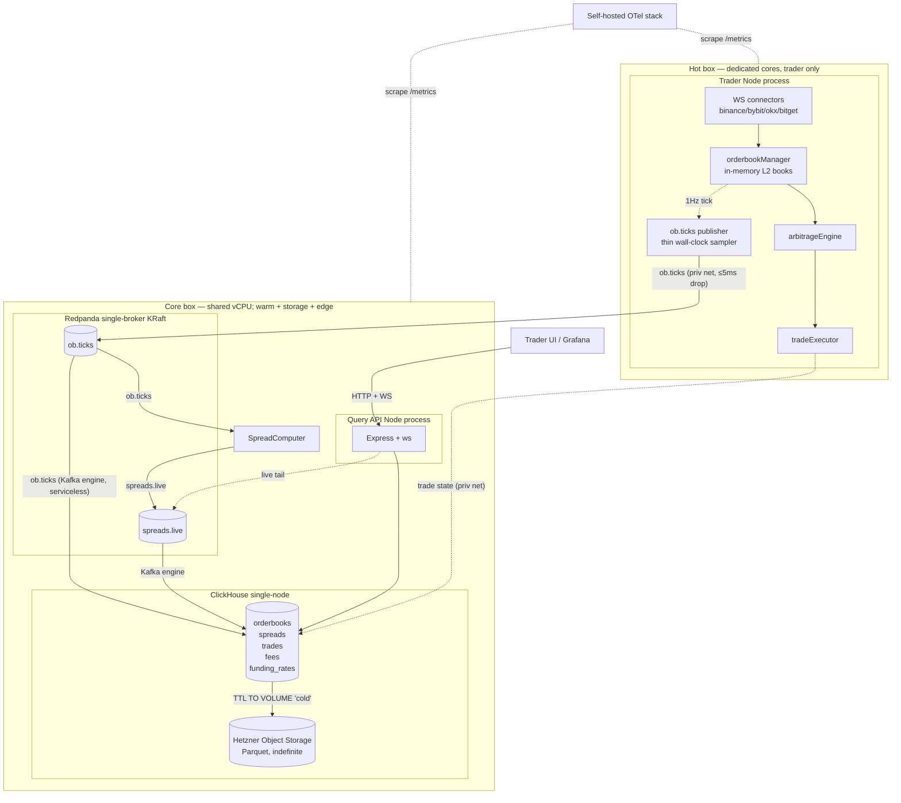

# 01 — Topology

Two-box service map. The **hot box** (dedicated cores) runs only the trader + a thin 1 Hz `ob.ticks` publisher. The **core box** (shared vCPU) runs Redpanda + SpreadComputer + ClickHouse + query-api. `ob.ticks` crosses the private net; everything on the core box is loopback. Host SKU/sizing/split is infra-owned → [`../../intents/infrastructure/infrastructure-provisioning.md`](../../intents/infrastructure/infrastructure-provisioning.md#concrete-arbinet-resource-declarations).

## Service map

## Process boundaries

Per-service memory/CPU caps live in the infra capacity spec → [`../../intents/infrastructure/capacity-and-cost.md`](../../intents/infrastructure/capacity-and-cost.md#process-resource-boundaries). Headroom on 16 vCPU / 32 GB: ~2 GB RAM and 1–2 vCPU left for bursts.

## Hot / warm / cold boundary

| Boundary | Backpressure rule | Failure mode |
|---|---|---|
| Hot → warm (cross-box publish to `ob.ticks`) | Produce timeout ≤ 5 ms; drop tick on timeout | Drop counter increments; hot path continues |
| Warm internal (`ob.ticks` → CH Kafka engine + SpreadComputer, core-box loopback) | Normal backpressure; consumers co-located with broker | Consumer lag bounded; relaxed timeout |
| Warm → store (Redpanda → CH) | At-most-once; consumer lag monitored | Lag alert fires; rollups lag but raw catches up |
| Store → cold (CH TTL) | Async background; CH manages | If S3 disk down, hot data still on NVMe + Volume |

## Failure isolation

| Process crashes | Survives | Loses |
|---|---|---|
| Trader (hot box) | Redpanda buffer (24 h), SpreadComputer, CH, Query API | In-flight ticks; `ob.ticks` production pauses; sequence gap on restart |
| SpreadComputer (core box) | Trader, Redpanda, CH (raw `ob.ticks` ingest continues serviceless) | `spreads.live` gap until restart |
| Redpanda (core box) | Trader (drops ticks), CH (no new data) | Anything not yet consumed (alert via lag) |
| ClickHouse (core box) | Trader (keeps trading; trade-state persist fails until restored), Redpanda (buffers up to retention) | Read availability; rollups freeze; trade-state writes |
| Query API (core box) | Trader, Redpanda, CH | UI only |
| Hot box | Core box (warm + store + edge intact) | Trade loop down; `ob.ticks` production stops |
| Core box | Hot box keeps trading (drops `ob.ticks`); cold tier on Object Storage | Warm pipeline + UI + trade-state persistence until restored |

Shared-fate split: the raw record path is **serviceless** — CH consumes `ob.ticks` directly via a Kafka engine, so no warm service sits between the buffer and the store and none can crash it. **SpreadComputer is the lone warm service**, a separate core-box app consuming `ob.ticks` (see [02](./02-snapshotter.md), [06](./06-spreads-engine.md)); a SpreadComputer bug stalls only `spreads.live`, never the raw `orderbooks` ingest. A trader crash no longer takes the warm path down; only `ob.ticks` production pauses. The hot box runs only the trade loop + the thin `ob.ticks` publisher on dedicated cores.

## Network topology (app view)

- Core-box inter-service traffic (Redpanda ↔ SpreadComputer ↔ CH ↔ query-api) on `127.0.0.1` loopback, no TLS. `ob.ticks` crosses the **private net** (hot box → core-box Redpanda `10.0.1.20:9092`, ≤5 ms drop). The trader also reaches **CH on the core box** (`10.0.1.20:8123`) over the private net for trade-state persist/restore — an **accepted third hot-box egress** (see [11](./11-redis-removal.md)).
- Outbound (hot box): exchange APIs (WS + REST), NTP, plus the two private-net flows above (`ob.ticks` + trade-state to the core box). Outbound (core box): Hetzner Object Storage, NTP.
- Public ingress and TLS termination for the Query API are infra-owned via **kamal-proxy (TLS, Let's Encrypt) on the core box** (Hetzner LB dropped) → [`../../intents/infrastructure/infrastructure-provisioning.md`](../../intents/infrastructure/infrastructure-provisioning.md#query-api-ingress-reframed). The query-api still binds `127.0.0.1` on the core box and is reached only via kamal-proxy.

## Links

- ob.ticks sampler detail → [02-snapshotter.md](./02-snapshotter.md)
- Redpanda config → [03-buffer-redpanda.md](./03-buffer-redpanda.md)
- CH schemas → [04-clickhouse-schemas.md](./04-clickhouse-schemas.md)
- Cold tier → [10-cold-path.md](./10-cold-path.md)
- Host resources & budget → [`../../intents/infrastructure/capacity-and-cost.md`](../../intents/infrastructure/capacity-and-cost.md)
