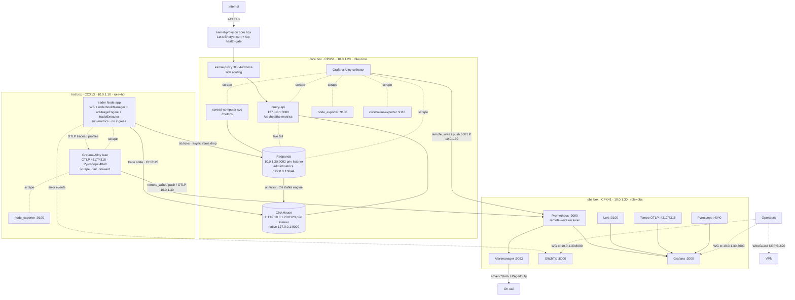
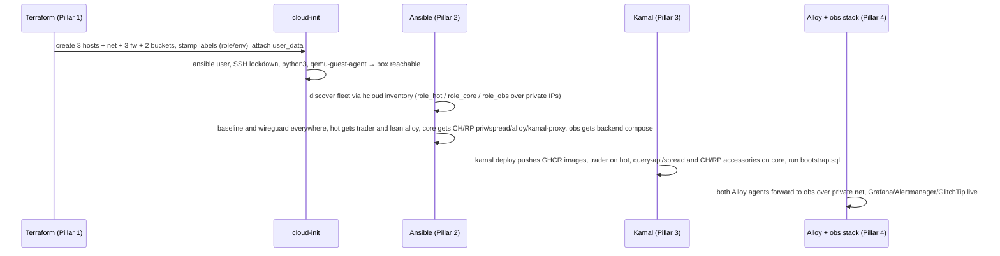

# 01 — Topology

The coherent whole. Three Terraform-provisioned, label-tagged Hetzner hosts on one private network: a lean **hot box** carrying the latency-sensitive trader process on dedicated cores, a **core box** carrying the warm/analytical tier (ClickHouse + Redpanda + query-api + the split-out spread-computer service + kamal-proxy), and an **obs box** carrying the observability backends. This file is the anchor the four pillars ([02](./02-provisioning.md)–[05](./05-observability.md)) reference; it fixes the host inventory, the private-network address plan, the loopback bindings, the `ob.ticks` warm path, the WireGuard overlay, the single public edge path, and the provision→config→deploy→observe wiring narrative.

## Why dedicated cores (hot box)

The trader hot path — WS ingest → in-memory orderbook → arbitrage detection → execution — is single-threaded and financially sensitive. Running it on **shared** vCPU exposes it to noisy-neighbor CPU steal/throttle, an unacceptable risk for a path that places real orders. **Resolution: the trader process runs alone on a dedicated-vCPU CCX13 (2 dedicated cores / 8 GB), kept lean** — no ingress, no Volume, no Redpanda. Everything warm/analytical moves to a shared-core CPX51 core box; observability lives on its own CPX41. The hot path stays isolated on cores that cannot be stolen. (Gaps **G2**, **G12**, **G13**; [08](./08-gaps-and-decisions.md).)

## Host inventory

| Host | SKU | Resources | Arch | Private IP | Label | Runs |
|---|---|---|---|---|---|---|
| **hot** | Hetzner CCX13 | 2 **dedicated** vCPU / 8 GB / 80 GB NVMe | amd64 | `10.0.1.10` | `role=hot, env=prod` | trader Node app (WS + orderbookManager + arbitrageEngine + tradeExecutor) **only**; lean Grafana Alloy agent. No ingress, no Volume, no Redpanda. |
| **core** | Hetzner CPX51 | 16 shared vCPU / 32 GB / 360 GB NVMe + 200 GB Volume | amd64 | `10.0.1.20` | `role=core, env=prod` | ClickHouse + Redpanda (KRaft) + query-api + **spread-computer svc** + kamal-proxy (TLS) + Grafana Alloy collector |
| **obs** | Hetzner CPX41 | 8 shared vCPU / 16 GB / 240 GB NVMe + 40 GB Volume | amd64 | `10.0.1.30` | `role=obs, env=prod` | Prometheus, Loki, Tempo, Pyroscope, Alertmanager, Grafana, GlitchTip (Ansible-managed compose stack) |

All three run Ubuntu 24.04 LTS in datacenter **NBG1** (same network zone, `eu-central`), **all amd64**. No ARM, no multi-arch builds.

## What runs where



- **Hot box** owns the hot path on dedicated cores. It exposes nothing off-host except three outbound flows: `ob.ticks` → core Redpanda, trade-state → core ClickHouse, and Alloy → obs box. No ingress, no Volume. Detail: [04-deployment.md](./04-deployment.md#kamal-apps-and-accessories).
- **Core box** owns the warm-path middleware and the only public edge (kamal-proxy TLS → query-api). Every data port binds `127.0.0.1` **except** Redpanda's Kafka listener and ClickHouse's HTTP port, which bind the private IP so the hot box can produce `ob.ticks` and persist/restore trade-state. Detail: [03-configuration.md](./03-configuration.md#core-box-middleware-roles), [04-deployment.md](./04-deployment.md#edge-and-tls-path).
- **Obs box** owns every observability backend. It has **no public service ports** — backends listen on its private IP `10.0.1.30`, reachable by both Alloy agents (private net) and operators (WireGuard) only. Detail: [05-observability.md](./05-observability.md#obs-box-backend-stack).

## Private-network address plan

`hcloud_network` **`prod-vpc`** — `10.0.0.0/16`, one subnet `10.0.1.0/24` in network zone `eu-central` (NBG1). This network is **load-bearing** (gap **G3**, [08](./08-gaps-and-decisions.md#g3)): it now carries a **warm data path** (`ob.ticks` from the hot box to the core box's Redpanda) plus the **trader↔ClickHouse trade-state flow** (hot box → core box CH `10.0.1.20:8123`), in addition to Alloy→obs telemetry and the Ansible control path.

| Endpoint | Address | Reachable from |
|---|---|---|
| hot private NIC | `10.0.1.10` | core box, obs box, WireGuard peers |
| core private NIC | `10.0.1.20` | hot box (Redpanda producer + ClickHouse trade-state client), obs box, WireGuard peers |
| obs private NIC | `10.0.1.30` | hot box, core box, WireGuard peers |
| WireGuard overlay | `10.8.0.0/24` (peers `10.8.0.2+`) | operators dialing in |
| Ansible control path | over `10.0.1.0/24` (inventory composes `ansible_host = private_net[0].ip`) | controller via WireGuard |

The private network carries: (1) the **warm `ob.ticks` data path** (hot → core Redpanda), (2) the **trader↔ClickHouse trade-state flow** (hot → core CH `10.0.1.20:8123`, persist/restore), (3) **telemetry** (both Alloy agents → obs), and (4) the **Ansible control path**. Co-resident data on the core box (CH ↔ Redpanda ↔ spread-computer/query-api) stays on `127.0.0.1` — with **two** private-bound exceptions, Redpanda's Kafka listener (`9092`) and CH's HTTP port (`8123`), both reached by the hot box.

## The `ob.ticks` warm path

```
hot box trader ──produce ob.ticks (async, ≤5 ms timeout, drop-on-timeout)──▶ core box Redpanda 10.0.1.20:9092
core box Redpanda ob.ticks ──┬─▶ CH Kafka engine ──▶ orderbooks   (raw system-of-record; NO service in path)
                             └─▶ spread-computer svc ──▶ spreads.live ──▶ ClickHouse (derived; lone warm service)
                             (all on the core box, loopback)
```

The trader publishes raw orderbook ticks to the core box's Redpanda at **1 Hz warm emit with a ≤5 ms produce timeout and drop-on-timeout** ([`../datapipeline/01-topology.md`](../datapipeline/01-topology.md)). This is **not** in the trade hot path — the hot path is fully in-process/in-memory; the warm emit is bounded and async, so a slow/blocked produce never stalls the trade loop. Latency cost: one sub-ms private-net RTT, well inside the 5 ms budget. From Redpanda, `ob.ticks` splits two ways: ClickHouse's **Kafka engine consumes `ob.ticks` directly into `orderbooks`** — the raw system-of-record path is **serviceless** (no warm process in it, so it cannot be crashed by a warm-service bug) — and the **spread-computer**, split out of the trader onto the core box, consumes `ob.ticks` → `spreads.live` → CH `spreads` as the lone warm processor. Isolation benefit: Redpanda's thread-per-core CPU appetite stays entirely off the 2 dedicated trader cores.

## Loopback vs private bindings

| Host | Service | Bind | Exposed off-host? |
|---|---|---|---|
| hot | trader app `/metrics`, `/up` | `127.0.0.1:9464` / `:8081` | No (scraped by local Alloy; `/up` probed by kamal — trader has no ingress) |
| hot | node_exporter | `127.0.0.1:9100` | No (scraped by local Alloy) |
| hot | Alloy receivers (OTLP, Pyroscope) | `127.0.0.1:4317/4318`, `127.0.0.1:4040` | No |
| core | **Redpanda Kafka API** | **`10.0.1.20:9092`** | **Yes — private net only** (hot box producer; firewall pins source to `10.0.1.0/24`) |
| core | Redpanda admin / Prometheus `/metrics` | `127.0.0.1:9644` | No (scraped by local Alloy) |
| core | **ClickHouse HTTP** | **`10.0.1.20:8123`** | **Yes — private net only** (hot-box trade-state client; firewall pins source to `10.0.1.0/24`) |
| core | ClickHouse native | `127.0.0.1:9000` | No |
| core | spread-computer `/metrics` | `127.0.0.1` | No (scraped by local Alloy) |
| core | node_exporter / clickhouse-exporter | `127.0.0.1:9100` / `:9116` | No (scraped by local Alloy) |
| core | query-api | `127.0.0.1:8080` | Only via kamal-proxy (TLS edge) |
| core | Alloy receivers (OTLP, Pyroscope) | `127.0.0.1:4317/4318`, `127.0.0.1:4040` | No |

**Redpanda's Kafka listener and ClickHouse's HTTP port are the two exceptions to loopback-only** — Redpanda's listener must accept the hot box's `ob.ticks` producer and CH's HTTP port must accept the hot box's trade-state client, so both bind the private IP (`10.0.1.20:9092`, `10.0.1.20:8123`; firewall pins source to `10.0.1.0/24`). CH native `9000`/query-api/spread-computer stay loopback. Both Alloy agents hold the only telemetry connections off their hosts (to `10.0.1.30`). This is the host-side half of the security posture in [02-provisioning.md](./02-provisioning.md#firewalls) and [03-configuration.md](./03-configuration.md#baseline-hardening-role).

## WireGuard overlay

Grafana and GlitchTip carry operational data and must not be public. Operators reach them over a **WireGuard** tunnel into the private network (gap **G11**, [08](./08-gaps-and-decisions.md#g11)):

- A `wireguard` Ansible role runs on **all three** hosts (each an endpoint on UDP `51820`); peers are assigned `10.8.0.0/24` addresses with `AllowedIPs` covering `10.0.1.0/24` + the host. Detail: [03-configuration.md](./03-configuration.md#wireguard-role).
- All three firewalls open UDP `51820` **only from operator source IPs** ([02](./02-provisioning.md#firewalls)). The obs firewall opens **nothing else** publicly; the hot firewall opens no public service ports either (only the core box has the 80/443 edge).
- Operator flow: dial WireGuard → reach `http://10.0.1.30:3000` (Grafana) and `http://10.0.1.30:8000` (GlitchTip). SSH to any host also goes over the tunnel. Onboarding runbook: [07-runbooks.md](./07-runbooks.md#wireguard-onboarding).

## Public edge path (single)

Exactly one public ingress, one TLS termination — terminated in **kamal-proxy on the core box** (gap **G5** reversed: the Hetzner LB is dropped because query-api is off the hot path, so host-side cert management is no longer a hot-path concern):

```
Internet ──443/TLS──▶ core box :443 kamal-proxy (Let's Encrypt managed cert, host-side)
                         │ host-side routing + /up health-gate
                         ▼
                      query-api  127.0.0.1:8080
```

TLS terminates **once, in kamal-proxy on the core box**. There is **no Hetzner LB**. The `trader` app on the hot box has no ingress at all (it only connects outward to exchanges, to the core box's Redpanda for `ob.ticks`, to the core box's ClickHouse for trade-state, and to its local Alloy). Putting the cert on the core box — not the hot box — keeps cert management off the dedicated trade cores. Edge detail: [04-deployment.md](./04-deployment.md#edge-and-tls-path).

## Provision → configure → deploy → observe wiring

The four pillars hand off through labels and a dynamic inventory; no tool invokes another directly.



1. **Provision** ([02](./02-provisioning.md)) — Terraform applies all three hosts, the network, three firewalls, both Object Storage buckets, and SSH keys; stamps `role`/`env` labels; attaches minimal cloud-init `user_data`. **No LB.** State lives in `arbinet-tfstate` with native lockfile.
2. **Configure** ([03](./03-configuration.md)) — Ansible discovers the fleet by label, applies `baseline` + `wireguard` to all hosts, then role-specific layers: hot gets `chrony` + lean `alloy` + trader prep; core gets `chrony`/`clickhouse`/`redpanda` (private listener)/`spread-computer`/`alloy`/`kamal-proxy`; obs gets the backend compose stack.
3. **Deploy** ([04](./04-deployment.md)) — locally-built **amd64-only** images pushed to GHCR; `kamal deploy` rolls the `trader` onto the hot box and the `query-api`/`spread-computer` apps + `clickhouse`/`redpanda` accessories onto the core box; `bootstrap.sql` runs as a one-shot; rollback is `kamal rollback`.
4. **Observe** ([05](./05-observability.md)) — Alloy on both hot and core boxes scrapes loopback exporters and forwards metrics/logs/traces/profiles to the obs box over the private net; Grafana, Alertmanager, and GlitchTip surface them.

## Failure isolation

| Failure | Survives | Loses |
|---|---|---|
| trader (hot box) app crash | core box (Redpanda buffer 24 h, CH, query-api), obs box | In-flight ticks; sequence gap on restart; no `ob.ticks` produced while down |
| **hot box loss** | **core box (all warm/analytical data) + obs box fully** | Live trading until re-provisioned; **no trade-state data loss** (warm data lives on the core box) |
| ClickHouse / Redpanda crash (core box) | hot box (trader keeps trading from in-memory state; `ob.ticks` produce drops-on-timeout), obs box | Read availability / unconsumed buffer (lag alert); warm ingest pauses; trade-state persist/restore to CH (trader runs from in-memory state until CH is back) |
| **obs box down** | **hot + core boxes fully — hot path unaffected** | Metrics/logs/traces/alerting blind until restored; no trade impact |
| **core box loss** | Cold tier in `arbinet-cold` (only durable copy); hot box (trading continues, `ob.ticks` drops); obs box | Hot+warm CH (3-day) + in-flight Redpanda — **no HA, no backups** (the no-backup risk now lives on the core box; gap **G10**, [08](./08-gaps-and-decisions.md#g10)) |
| kamal-proxy / core box edge down | hot box (trading continues) | Public query-api ingress only; trading unaffected |

The **core box** is now the data box: its loss is the unrecoverable one (Terraform re-provision + replay from cold tier, [07-runbooks.md](./07-runbooks.md#host-rebuild-recovery)). Hot-box loss, by contrast, loses no stored data — the warm/analytical state lives on the core box. This is an explicit no-HA acceptance, not an oversight.

## Links

- Provisioning the hosts/network/firewalls/buckets (no LB) → [02-provisioning.md](./02-provisioning.md)
- Configuring all three hosts → [03-configuration.md](./03-configuration.md)
- Deploying the app layer across 2 hosts → [04-deployment.md](./04-deployment.md)
- Observing it → [05-observability.md](./05-observability.md)
- Sizing all three hosts & budget → [06-capacity-and-cost.md](./06-capacity-and-cost.md)
- Recovery & operations → [07-runbooks.md](./07-runbooks.md)
- Gaps resolved here (G2, G3, G5, G10, G11, G12, G13) → [08-gaps-and-decisions.md](./08-gaps-and-decisions.md)
- Workload that runs on this topology → [`../datapipeline/01-topology.md`](../datapipeline/01-topology.md)
</content>
