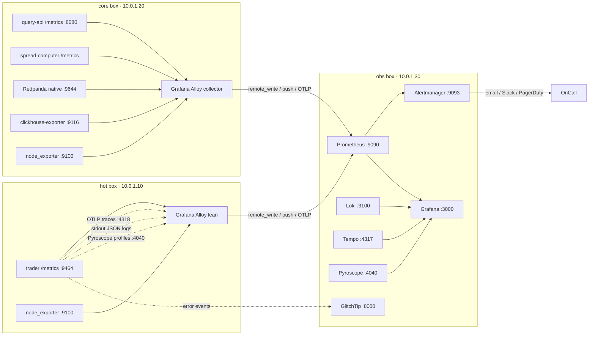

# 05 — Observability (Pillar 4)

Self-hosted OpenTelemetry observability, split across the three hosts ([01](./01-topology.md)): a **Grafana Alloy** agent on **both** the hot box (lean) and the core box (full collector) collects every signal on loopback and forwards it over the private network to the **obs box**, which runs all the backends. OpenTelemetry is the instrumentation standard; W3C TraceContext is the propagation format. This file carries the full metric catalog, SLI/SLO table, alert rules, dashboards, and cardinality budget inline.

> **Ownership split.** The metric *names* each app service emits are an app **instrumentation contract** ([`../datapipeline/08-observability.md`](../datapipeline/08-observability.md#metric-names-the-app-must-emit)). Scraping, alerting, dashboards, cardinality budgeting, retention, and the backend stack are infra and live here.

## Why two Alloy agents, backends on the obs box

The trader split across two hosts (G12) means signals originate on **both** the hot box (trader) and the core box (spread-computer, query-api, CH, Redpanda). So **Alloy runs on both**: a **lean** agent on the hot box (scrape trader + node_exporter, receive OTLP/Pyroscope, forward) and a **full collector** on the core box (scrape the warm services + CH/Redpanda exporters, tail logs, forward). Each forwards to the obs box; neither carries a backend. This replaces the deferred "OTel Collector vs Alloy" and "Vector vs Fluent Bit" choices with a single binary type (gap **G8**; Parca/eBPF dropped, Pyroscope-only). The heavy backends (Prometheus/Loki/Tempo/Pyroscope/Grafana/Alertmanager/GlitchTip) **do not fit the hot or core boxes** and live on the obs box (gap **G2**). Error tracking is **GlitchTip** (Sentry-compatible) and on-call routing is **Alertmanager**.

## Signal flow over the private network

Both Alloy agents scrape loopback exporters on their hosts, then **remote-write** metrics to Prometheus (`10.0.1.30:9090`), **push** logs to Loki (`:3100`), forward **OTLP** traces to Tempo (`:4317`), and **push** profiles to Pyroscope (`:4040`) — all over the private net. The trader SDK sends error events directly to GlitchTip (`:8000`). Operators view Grafana/GlitchTip over WireGuard ([01](./01-topology.md#wireguard-overlay)).

## Obs-box backend stack

Ansible-managed compose stack on the obs box ([03](./03-configuration.md#obs-box-backend-roles)). All listen on the private IP `10.0.1.30`; none is public (fw-obs, [02](./02-provisioning.md#firewalls)):

| Backend | Port | Role | Retention | Data dir |
|---|---|---|---|---|
| Prometheus | `:9090` | metrics store + recording/alert rules; remote-write receiver | 15 d | `/mnt/obs-data/prometheus` |
| Loki | `:3100` | log store | 7 d | `/mnt/obs-data/loki` |
| Tempo | `:4317/4318` | trace store (OTLP) | 72 h | `/mnt/obs-data/tempo` |
| Pyroscope | `:4040` | continuous profiles | 7 d | `/mnt/obs-data/pyroscope` |
| Alertmanager | `:9093` | alert routing (email/Slack/PagerDuty) | — | `/mnt/obs-data/alertmanager` |
| Grafana | `:3000` | single pane (metrics/logs/traces/profiles); WireGuard-only | — | `/mnt/obs-data/grafana` |
| GlitchTip | `:8000` | error tracking (Sentry-compatible) + Postgres + Redis; WireGuard-only | 30 d events | `/mnt/obs-data/glitchtip` |

Storage sizing for these on the 40 GB obs Volume: [06](./06-capacity-and-cost.md#obs-box-storage-and-retention).

## Trace / log / profile correlation

The stack's payoff is **navigation across signals** — metric anomaly → offending trace exemplar → correlated logs for that `trace_id` → flame graph for that span. With the trader split across two hosts, a `trace_id` must flow **hot → core** across the `ob.ticks` boundary so a trade-loop span links to its downstream snapshot/spread spans.

- `trace_id` and `span_id` flow through **every** signal; the app SDK injects them into structured logs and **propagates them across the `ob.ticks` produce** (SpreadComputer continues the trace on consume), so a hot-box span and its core-box continuation share one trace.
- Enablers: **OpenTelemetry exemplars** (trace IDs embedded in Prometheus histograms) and **Grafana data links** (click-through from a metric/log to the trace and back). Configured in the `grafana` role's datasource provisioning ([03](./03-configuration.md#obs-box-backend-roles)).
- Priority order: **Metrics → Traces → Profiles → Logs.** Logs are expensive noise — sampled, not firehosed.

## Metric catalog

Scraped by Alloy on the hot + core boxes, remote-written to Prometheus. Metric *names* are the app contract ([`../datapipeline/08-observability.md`](../datapipeline/08-observability.md#metric-names-the-app-must-emit)); thresholds below are infra-owned.

**Scrape interval.** Alloy scrapes hot-path exporters (trader `/metrics`, hot-box node_exporter) at **5 s**; warm services (spread-computer, query-api), middleware (Redpanda, CH), and core/obs host exporters at **15 s**. Justification: a 15 s scrape cannot catch sub-second hot-path SLO breaches (tick-to-trade, event-loop lag, WS staleness), so the hot path is scraped 3× faster.

All histogram metrics resolve to a defined bucket set in [Histogram buckets](#histogram-buckets) below; every catalog histogram must appear there.

### Trader (hot box, app `/metrics`)

| Metric | Type | Purpose |
|---|---|---|
| `sequence_gap_total{exchange,type}` | Counter | WS continuity (`symbol` dropped → trace exemplar; cardinality offset) |
| `exchange_clock_skew_seconds{exchange}` | Histogram | `ts − ts_exchange` p50/p95 |
| `ws_health{exchange}` | Gauge | 1 = up, 0 = down |
| `arb_opportunities_detected_total{strategy}` | Counter | Engine output |
| `trade_executions_total{result}` | Counter | Hot path; `result` ∈ {`filled`,`partial`,`rejected`,`timeout`,`rollback`} |
| `ob_ticks_produce_seconds` | Histogram | **Warm-hop produce latency** (hot → core Redpanda); p99 must sit well under the 5 ms drop budget |
| `ob_ticks_produce_dropped_total{reason}` | Counter | **Drop-on-timeout count** — produce exceeded the ≤5 ms budget |

#### Hot-path latency & freshness (trader)

| Metric | Type | Unit | Labels | Purpose |
|---|---|---|---|---|
| `tick_to_trade_seconds` | Histogram | s | `{stage}` (`ws_recv`,`book_apply`,`opp_detect`,`decision`) | In-process hot-path decomposition; one histogram, stage-labeled (flat cardinality), `trace_id` exemplars for per-symbol drill-down |
| `exchange_order_latency_seconds` | Histogram | s | `{exchange,phase}` (`submit_to_ack`,`ack_to_fill`) | Exchange-side RTT & fill latency |
| `ws_messages_received_total` | Counter | — | `{exchange,type}` | Message-rate floor; 0 = silent stall |
| `ws_staleness_seconds` | Gauge | s | `{exchange}` | **Silent failure**: book stale while `ws_health==1` |
| `ws_reconnects_total` | Counter | — | `{exchange}` | Feed flapping |
| `orderbook_age_seconds` | Histogram | s | `{exchange}` | Book freshness feeding decisions |
| `orderbook_apply_seconds` | Histogram | s | — | Update-apply latency on hot path |
| `orderbook_crossed_total` | Counter | — | `{exchange}` | Crossed/locked = bad data → bad trade |
| `orderbook_resync_total` | Counter | — | `{exchange,reason}` | Delta-before-snapshot desync drops |

#### Node runtime (trader, single-thread)

`prom-client` `collectDefaultMetrics()` + `perf_hooks.monitorEventLoopDelay`.

| Metric | Type | Unit | Labels | Purpose |
|---|---|---|---|---|
| `nodejs_eventloop_lag_seconds` | Histogram | s | — | Blocked loop = missed ticks; the silent killer |
| `nodejs_gc_duration_seconds` | Histogram | s | `{kind}` | GC pause stalls the trade loop |
| `nodejs_heap_used_bytes` | Gauge | bytes | — | App-level leak (OS RSS via node_exporter) |

#### Trading / risk / strategy (trader)

| Metric | Type | Unit | Labels | Purpose |
|---|---|---|---|---|
| `arb_funnel_total` | Counter | — | `{reason}` (9 values, see contract) | *Why* opportunities die at each reject point |
| `arb_opportunities_missed_total` | Counter | — | `{reason}` (`too_slow`,`risk_blocked`,`insufficient_balance`) | Detected but not acted |
| `order_fills_total` | Counter | — | `{exchange,status}` (`filled`,`partial`,`rejected`,`canceled`,`timeout`) | Fill/partial/reject rate |
| `order_reject_total` | Counter | — | `{exchange,reason}` | Reject reasons |
| `trade_slippage_bps` | Histogram | bps | `{side}` | Realized vs expected price |
| `trade_edge_expected_bps` | Histogram | bps | `{strategy}` | Theoretical edge at decision |
| `trade_edge_realized_bps` | Histogram | bps | `{strategy}` | Edge actually captured |
| `trade_rollback_total` | Counter | — | `{reason}` | **P0**: partial-fill unwind, stuck-position risk |
| `open_positions` | Gauge | — | `{exchange}` | Live inventory count |
| `position_notional_usd` | Gauge | USD | `{exchange}` | Gross exposure |
| `net_exposure_usd` | Gauge | USD | — | Net delta across venues |
| `exposure_limit_utilization_ratio` | Gauge | ratio | — | vs `maxPositionAmountUsd` |
| `portfolio_pnl_usd` | Gauge | USD | `{type}` (`realized`,`unrealized`) | Capital tracking |
| `portfolio_drawdown_usd` | Gauge | USD | — | Drawdown for stop trigger |
| `venue_balance_usd` | Gauge | USD | `{exchange}` | Balance per venue |
| `account_state_age_seconds` | Gauge | s | `{exchange,type}` | **P0 silent failure**: trading on stale state |
| `kill_switch_active` | Gauge | — | — | 1/0 — are we halted? |
| `circuit_breaker_trips_total` | Counter | — | `{reason}` | Why we halted |
| `risk_check_rejections_total` | Counter | — | `{check}` (`balance`,`active_orders`,`opposite_position`,`max_position`) | Pre-trade gate hits |
| `open_trades` | Gauge | — | `{strategy,variant}` | Live trade count |
| `trade_hold_duration_seconds` | Histogram | s | `{exit_reason}` (`take-profit`,`convergence`,`spread-widening`,`timeout`,`manual`,`error`) | Hold time by exit path |
| `funding_collected_usd_total` | Counter | USD | — | Funding-arb realized income |

### Spread engine (core box, app `/metrics`)

| Metric | Type | Purpose |
|---|---|---|
| `spread_engine_drop_total{reason}` | Counter | Spread drops |
| `spread_engine_rows_emitted_total` | Counter | Throughput |

Warm-hop consume lag is no longer app-emitted — both `ob.ticks` consumers are Redpanda consumer groups, tracked via `redpanda_kafka_consumer_group_lag{group="ch_orderbooks"}` (the serviceless CH Kafka engine into `orderbooks`) and `{group="spread_ticks"}` (SpreadComputer).

### Redpanda (core box, native Prometheus endpoint `:9644`)

| Metric | Threshold |
|---|---|
| `redpanda_kafka_under_replicated_partitions` | always 0 (single replica) |
| `redpanda_producer_queue_bytes` | alert >40 MB |
| `redpanda_kafka_consumer_group_lag` | alert >5 (seconds of consumer lag) |
| `redpanda_disk_free_bytes` | alert <30 GB (core Volume now 200 GB) |

### ClickHouse (core box, `clickhouse-exporter :9116`)

| Metric | Threshold |
|---|---|
| `clickhouse_query_duration_seconds` (Histogram) | alert `histogram_quantile(0.95, …) > 5 s` |
| `clickhouse_inserted_rows_total` | sanity |
| `clickhouse_parts_active` | alert >300 per table |
| `clickhouse_async_insert_pending_bytes` | sanity |
| `mv_freshness_seconds{view}` | derived: `now() − max(bucket)` |
| `clickhouse_s3_disk_get_requests_total` | cold-tier cost watch |

### Query API (core box, app `/metrics`)

| Metric | Type | Unit | Labels |
|---|---|---|---|
| `qapi_http_duration_seconds` | Histogram | s | `{route}` |
| `qapi_ws_clients` | Gauge | — | — |
| `qapi_ws_messages_pushed_total` | Counter | — | `{channel}` |
| `qapi_ch_errors_total` | Counter | — | `{route}` |
| `qapi_cache_hits_total` | Counter | — | `{route}` |

### Host (`node_exporter :9100` — on **all three** hosts)

Standard CPU/mem/disk/net, plus: `node_disk_io_time_seconds_total` per device (core box: NVMe vs Volume), `node_filesystem_avail_bytes{mountpoint="/mnt/ch-volume"}` (core), `node_filesystem_avail_bytes{mountpoint="/mnt/obs-data"}` (obs), `node_filesystem_avail_bytes{mountpoint="/"}` (all hosts — image-prune watch), `chrony_tracking_last_offset_seconds` (hot + core). The hot box's node_exporter is the source for the **CCX13 RAM tightness watch** (`node_memory_*` → trader RSS vs 8 GB; CCX23 upgrade trigger, [06](./06-capacity-and-cost.md#scaling-triggers)). `node_cpu_seconds_total{mode="steal"}` on the hot box should sit at **~0** — dedicated cores; any sustained steal is an isolation regression.

## Histogram buckets

Quantiles are only as meaningful as the bucket boundaries; every histogram in the catalog resolves to one of these sets. Boundaries are in **base SI units** (seconds, bps) per the metric.

| Bucket set | Boundaries | Applies to | Justification |
|---|---|---|---|
| **In-process hot path** | `[0.0001, 0.00025, 0.0005, 0.001, 0.0025, 0.005, 0.01, 0.025, 0.05, 0.1]` (0.1 ms–100 ms) | `tick_to_trade_seconds`, `orderbook_apply_seconds`, `nodejs_eventloop_lag_seconds` | In-process Node work is sub-ms–few-ms; loop stalls surface in the 10–100 ms tail |
| **Exchange RTT** | `[0.005, 0.01, 0.025, 0.05, 0.1, 0.25, 0.5, 1, 2.5, 5]` (5 ms–5 s) | `exchange_order_latency_seconds` | Venue RTT 10–100 ms typical; fills 100 ms–seconds |
| **Freshness** | `[0.05, 0.1, 0.25, 0.5, 1, 2, 5]` | `orderbook_age_seconds` (and `ws_staleness_seconds` if exported as a histogram) | Book/feed freshness; >2 s is fiction |
| **Edge / slippage** | `[-50, -20, -10, -5, -2, 0, 2, 5, 10, 20, 50]` (linear bps) | `trade_slippage_bps`, `trade_edge_expected_bps`, `trade_edge_realized_bps` | Edge/slippage span both signs; linear bps reads directly |
| **Hold duration** | `[1, 5, 15, 30, 60, 120, 300, 600, 1800, 3600, 21600]` (s) | `trade_hold_duration_seconds` | Holds range seconds (spread) to hours (funding window) |
| **Clock skew** | `[0.01, 0.025, 0.05, 0.1, 0.2, 0.5, 1]` (s) | `exchange_clock_skew_seconds` | SLO is 200 ms p95; buckets bracket it |
| **Warm-hop produce** | `[0.0005, 0.001, 0.002, 0.0035, 0.005, 0.0075, 0.01, 0.025]` (s) | `ob_ticks_produce_seconds` | Bracket the ≤5 ms drop budget |
| **CH query / qapi HTTP** | `[0.05, 0.1, 0.25, 0.5, 1, 2.5, 5, 10]` (s) | `clickhouse_query_duration_seconds`, `qapi_http_duration_seconds` | Query latency 50 ms–seconds; SLO at 5 s / 500 ms |

`nodejs_gc_duration_seconds` uses the `prom-client` default GC buckets (`[0.001, 0.01, 0.1, 1, 2, 5]`). The Node-default histograms emitted by `collectDefaultMetrics()` keep their library-default buckets.

## SLIs / SLOs

SLOs are computed over a **30-day rolling window**; SLO violations fire as **burn-rate alerts** on **1 h (fast-burn) and 6 h (slow-burn)** windows rather than raw thresholds.

| SLI | Target (SLO) |
|---|---|
| `ob.ticks` produce latency (warm hop) | < 5 ms p99 (the drop budget) |
| `ob.ticks` produce drop rate | < 0.1 % over 5 min |
| `ob.ticks` → CH (`ch_orderbooks`) consumer lag (+ `spread_ticks`) | < 1 s p99 |
| Spread emit drop rate | < 0.1 % over 5 min |
| CH consumer lag | < 5 s p99 |
| MV freshness (per tier) | < 3× bucket size |
| Exchange clock skew | < 200 ms p95 |
| Query API latency | < 500 ms p95 HTTP, < 100 ms WS push age |
| WS health | > 99 % per exchange |
| Hot-box CPU steal | ~0 (dedicated cores) |
| Internal tick-to-trade (`ws_recv`→`decision`) | < 5 ms p99 — in-process; >5 ms means we lose the race |
| Opportunities acted within budget | > 95 % acted < 250 ms — spread-arb edge decays sub-second |
| WS staleness | < 2 s p99 per exchange — beyond 2 s the book is fiction |
| Event-loop lag | < 50 ms p99 — above this, ticks silently drop |
| Order fill rate | > 90 % `filled`/submitted — low fill = adverse selection |
| Slippage | p95 < 10 bps — slippage erodes captured edge |
| Account-state freshness | < 30 s — stale state = blind risk checks |

Expressed as Prometheus **recording rules + SLO burn-rate alerts** (a burn-rate alert fires when the error budget is consumed too fast — more actionable than a raw threshold, less alert fatigue), not just raw thresholds.

## Alert rules

| Alert | Rule | Severity | Routes to |
|---|---|---|---|
| `trader_down` | absence of `trade_executions_total` / `ws_health` from the hot box for 30 s | crit | PagerDuty + Slack |
| `ws_down` | `ws_health == 0` for 1 min | crit | PagerDuty + Slack |
| `ob_ticks_drops` | `increase(ob_ticks_produce_dropped_total[5m]) / increase(...produce_total[5m]) > 0.001` | warn | Slack |
| `ob_ticks_lag` | `redpanda_kafka_consumer_group_lag{group="ch_orderbooks"} > 1` for 2 min | warn | Slack |
| `ingest_lag` | `redpanda_kafka_consumer_group_lag{group=~"ch_.*"} > 5` for 2 min | warn | Slack |
| `mv_stale` | `mv_freshness_seconds{view="spreads_15s"} > 45` for 2 min | warn | Slack |
| `ch_query_slow` | `histogram_quantile(0.95, clickhouse_query_duration_seconds) > 5` for 5 min | warn | Slack |
| `disk_low` | `node_filesystem_avail_bytes{mountpoint="/mnt/ch-volume"} < 40 GB` | warn | Slack + email |
| `hot_mem_high` | `node_memory_MemAvailable_bytes{host="hot"} < 1 GB` for 10 min | warn | Slack (CCX23 upgrade trigger) |
| `hot_cpu_steal` | `rate(node_cpu_seconds_total{mode="steal",host="hot"}[5m]) > 0.02` for 5 min | warn | Slack (dedicated-core isolation regression) |
| `clock_skew` | `histogram_quantile(0.95, exchange_clock_skew_seconds) > 0.2` for 5 min | info | Slack |
| `obs_target_down` | `up{job=~"trader\|query-api\|spread-computer\|node\|clickhouse\|redpanda"} == 0` for 2 min | warn | Slack |

`disk_low` fires at <40 GB free on the now-200 GB core Volume — the trigger for Volume expansion ([06](./06-capacity-and-cost.md#scaling-triggers); runbook [07](./07-runbooks.md#volume-expand)). `obs_target_down` now covers **both** Alloy agents (a failing hot-box scrape and a failing core-box scrape both surface). Alertmanager routes by severity (config in the `alertmanager` role, [03](./03-configuration.md#obs-box-backend-roles)). Per-alert incident response: [07-runbooks.md](./07-runbooks.md#incident-response-per-alert).

### Trader page-now alerts (capital at risk / blind / stuck)

Each names a human action; these wake on-call.

| Alert | Condition | Severity | Action |
|---|---|---|---|
| `ws_stale_blind` | `ws_staleness_seconds > 2` for 30 s (while `ws_health==1`) | crit / page | Feed is fiction — halt strategy on that venue |
| `account_state_stale` | `max(account_state_age_seconds) > 60` for 1 min | crit / page | Stop trading; resync account state from venue |
| `eventloop_lag_high` | `histogram_quantile(0.99, nodejs_eventloop_lag_seconds) > 0.1` for 2 min | crit / page | Loop blocked — investigate sync work / GC |
| `stuck_position` | `increase(trade_rollback_total{reason="leg_unwind_failed"}[5m]) > 0` | crit / page | One-legged position — manually flatten |
| `exposure_breach` | `exposure_limit_utilization_ratio > 1` | crit / page | Over limit — trip kill-switch |
| `drawdown_breach` | `portfolio_drawdown_usd < -<X>` (threshold = business input) | crit / page | Stop-loss trip |
| `kill_switch_on` | `kill_switch_active == 1` for 1 min | crit / page | Confirm the halt is intended |

### Trader ticket / warn alerts (degradation, not bleeding)

| Alert | Condition | Severity | Routes to |
|---|---|---|---|
| `slippage_high` | `histogram_quantile(0.95, trade_slippage_bps) > 20` for 10 min | warn | Slack |
| `fill_rate_low` | `filled / submitted < 0.80` over 10 min | warn | Slack |
| `funnel_anomaly` | `increase(arb_opportunities_detected_total[5m]) > 0` AND acted == 0 for 5 min | warn | Slack (silent miss) |
| `reject_spike` | `rate(order_reject_total[5m])` up vs baseline | warn | Slack |
| `t2t_slow` | `histogram_quantile(0.99, tick_to_trade_seconds) > 0.005` for 5 min | warn | Slack |
| `cardinality_high` | `prometheus_tsdb_head_series > 6000` | warn | Slack (cardinality overage — trim labels, see [budget](#series-cardinality-budget)) |

Drawdown/exposure dollar thresholds (`<X>`) are business input, not derivable from code — see [Open questions](#open-questions-deferred).

## Dashboards

1. **Hot path** — WS health, opportunity rate, trade executions, latency to exchange, hot-box CPU steal (~0). **Extended** with event-loop lag (`nodejs_eventloop_lag_seconds` p99) + GC pause (`nodejs_gc_duration_seconds`) panels.
2. **Warm path** — `ob.ticks` produce latency/drop + consume lag, spread emit rate, drop rate, Redpanda lag, MV freshness, CH inserts/s.
3. **Capacity** — disk, RAM, CPU per service (all three hosts), hot-box RSS vs 8 GB (CCX23 trigger), Redpanda buffer, CH parts.
4. **Trader UI live** — spread top-50, per-pair history (mirror of UI queries).
5. **Obs-box self** — CPX41 CPU/mem/disk, backend up/scrape health, TSDB/Loki/Tempo store size vs retention.

New trader dashboards (each answers one question):

6. **Tick-to-Trade Latency** — `tick_to_trade_seconds` stage heatmap + `exchange_order_latency_seconds` by phase. *"Where is tick-to-trade latency spent?"*
7. **Are We Trading Blind?** — `ws_staleness_seconds`, `orderbook_age_seconds`, `sequence_gap_total`, `account_state_age_seconds`. *"Is our data stale/wrong right now?"*
8. **Opportunity Funnel** — detected → acted → filled → missed, broken down by `arb_funnel_total` / `arb_opportunities_missed_total` reasons. *"Why aren't we trading?"*
9. **Risk & Inventory** — `open_positions`, `position_notional_usd`, `net_exposure_usd`, `exposure_limit_utilization_ratio`, `portfolio_pnl_usd`, `portfolio_drawdown_usd`, `kill_switch_active`. *"How much capital is at risk?"*
10. **Execution Quality** — `order_fills_total` fill rate, `trade_slippage_bps` distribution, `order_reject_total`, `trade_rollback_total`, `trade_edge_expected_bps` vs `trade_edge_realized_bps`. *"Are our fills any good?"*

## Series-cardinality budget

Self-hosted Prometheus has no SaaS per-series fee, but cardinality bounds the obs-box's memory/TSDB cost (Prometheus budgeted ~2 GB on the CPX41, [06](./06-capacity-and-cost.md#obs-box-process-boundaries)).

| Source | Approx series |
|---|---|
| Trader (per-exchange top contributors + `ob_ticks_*` + hot-path/risk/strategy additions) | ~2.0–2.2 k |
| Spread engine | ~50 |
| Redpanda | ~500 |
| CH exporter | ~1 k |
| Query API (per-route) | ~50 |
| node_exporter (**×3 hosts**) | ~1.5 k |
| **Total** | **~5.5–5.7 k** |

Histograms cost `buckets + 2` series each (`_sum`, `_count`). New trader series from the hot-path/risk/strategy additions (in-process buckets = 12, RTT/edge = 12, freshness = 9):

| Group | Series |
|---|---|
| Hot-path latency: t2t (4 stages × 12) + exchange RTT (8 × 12) | ~144 |
| WS: msgs 12 + staleness 4 + reconnects 4 + seq-gap now 12 | ~32 |
| Orderbook: age (4 × 9) + apply 12 + crossed 4 + resync 12 | ~64 |
| Node runtime: eventloop 12 + gc ~6 + heap 1 + defaults ~30 | ~50 |
| Funnel: 9 + 3 | ~12 |
| Execution: fills 20 + reject 16 + slippage (2 × 12) + edge (2 × 2 × 12) + rollback 6 | ~114 |
| Risk: positions/notional/balance (4 × 3) + scalars ~6 + state-age 12 + cb 6 + risk-check 5 | ~41 |
| Strategy: open_trades 6 + hold (6 × 12 incl. _sum/_count) + funding 1 | ~79 |
| **New total** | **~540** |

**Offset.** Dropping `symbol` from `sequence_gap_total` removes the single largest per-symbol contributor (part of the budgeted ~2 k "per-symbol top contributors"), freeing **hundreds** of series and absorbing most of the ~540 new series. Net trader allocation lands ≈ 2.0–2.2 k; **total stays ≈ 5.5–5.7 k**.

If series growth threatens obs-box RAM, prune in priority order: (1) cut `trade_hold_duration_seconds` to 7 buckets; (2) drop `{strategy}` from the edge histograms; (3) collapse `exchange_order_latency_seconds` to `{phase}` only; then other per-symbol labels. The `cardinality_high` self-alert fires at `prometheus_tsdb_head_series > 6000`. Scaling trigger: [06](./06-capacity-and-cost.md#scaling-triggers).

## Open questions (deferred)

- **`drawdown_breach` / `exposure_breach` dollar thresholds** (`<X>`) — business input (risk appetite), not derivable from code; set before enabling those page-now alerts.
- **`trade_executions_total{result}` and `order_fills_total{status}` enum domains** — target-state design; the current `TradeResult` carries only `success: boolean` (`tradeExecutor.ts:43`). `trade_hold_duration_seconds{exit_reason}` domain mirrors `tradeMonitor.ts:46` (`take-profit`/`convergence`/`spread-widening`/`timeout`/`manual`/`error`).

## Links

- Where Alloy + backends run → [01-topology.md](./01-topology.md)
- Obs firewall (no public ports) → [02-provisioning.md](./02-provisioning.md#firewalls)
- Alloy (hot + core) + obs backend roles → [03-configuration.md](./03-configuration.md#obs-box-backend-roles)
- Verifying the deploy is observed → [04-deployment.md](./04-deployment.md#deploy-flow)
- Obs-box sizing, storage & retention → [06-capacity-and-cost.md](./06-capacity-and-cost.md)
- Per-alert incident response → [07-runbooks.md](./07-runbooks.md#incident-response-per-alert)
- Gaps resolved here (G2, G8, G12, G13) → [08-gaps-and-decisions.md](./08-gaps-and-decisions.md)
- App instrumentation contract (metric names emitted) → [`../datapipeline/08-observability.md`](../datapipeline/08-observability.md)
</content>
