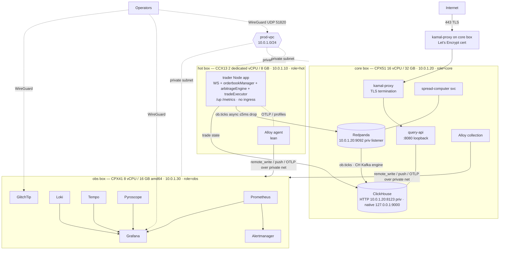

# ARBINET Hetzner Infrastructure — Design Index

## Purpose

The **provision → configure → deploy → observe** architecture for ARBINET on Hetzner Cloud. This is the **first** of two sequential tasks; the orderbook data pipeline ([`../datapipeline/`](../datapipeline/README.md)) is the **second** and depends on this infrastructure being live.

This spec set turns four pillars — **provisioning** (Terraform), **configuration** (Ansible), **deployment** (Kamal), **observability** (self-hosted OTel) — into one coherent, buildable design, plus operational runbooks, and surfaces every gap rather than papering over it ([08-gaps-and-decisions.md](./08-gaps-and-decisions.md)).

The design's load-bearing decision: **the HFT trade hot path must not run on shared vCPU.** The trader's WS-ingest → in-memory orderbook → arbitrage detection → execution loop is a financial-risk path; on shared cores it is exposed to noisy-neighbor steal/throttle. Resolution: **dedicated-vCPU (CCX13) hot box, kept lean**, with everything warm/analytical (ClickHouse + Redpanda + query-api + the split-out spread-computer service) on a regular **CPX51 core box**, and observability on its own **CPX41 obs box**. This makes the private network a **warm data path** (the hot box publishes raw `ob.ticks` to the core box's Redpanda) on top of telemetry, and reshapes provisioning, configuration, and the cost model.

## Audience

Engineers standing up and operating the ARBINET hosts. Read top-to-bottom for the end-to-end picture; each file is self-contained for focused work.

## How to read

1. [01-topology.md](./01-topology.md) — the coherent whole: three-host layout, what runs where, the provision→config→deploy→observe wiring. **Start here.**
2. Then the four pillars in build order: [02-provisioning.md](./02-provisioning.md) → [03-configuration.md](./03-configuration.md) → [04-deployment.md](./04-deployment.md) → [05-observability.md](./05-observability.md).
3. [06-capacity-and-cost.md](./06-capacity-and-cost.md) — sizing & budget contract that gates the above.
4. [07-runbooks.md](./07-runbooks.md) — operational procedures cutting across pillars.
5. [08-gaps-and-decisions.md](./08-gaps-and-decisions.md) — every gap/conflict found, its resolution, and remaining input needed.

## Three-host topology

Three Terraform-provisioned, label-tagged Hetzner hosts on one private network. The **hot box (CCX13, 2 dedicated vCPU)** runs the trader Node app **only** (WS + orderbookManager + arbitrageEngine + tradeExecutor) plus a lean Alloy agent — no ingress, no Volume. The **core box (CPX51)** runs ClickHouse + Redpanda + query-api + the **split-out spread-computer service** + kamal-proxy (TLS) + an Alloy collector. The **obs box (CPX41, amd64)** runs the backend stack as an Ansible-managed compose stack. The hot box publishes raw `ob.ticks` to the core box's Redpanda over the private net (async, ≤5 ms produce timeout, drop-on-timeout) and persists/restores trade-state to the core box's ClickHouse (`10.0.1.20:8123`) over the private net; both Alloy agents ship telemetry to the obs box. Public ingress terminates TLS at **kamal-proxy on the core box** (no Hetzner LB) → query-api. Operators reach Grafana/GlitchTip via WireGuard. cloud-init makes the boxes reachable; Ansible (dynamic inventory keyed on `role=hot|core|obs`) makes them useful; Kamal deploys the app layer; Alloy + the obs stack observe it.

## Decisions table

| Topic | Decision |
|---|---|
| Hot-path isolation | **Dedicated cores.** Hot box Hetzner **CCX13** (2 dedicated vCPU / 8 GB) runs the trader process only — no noisy-neighbor steal on the financial hot path. |
| Warm/analytics | **Core box** Hetzner **CPX51** (16 shared vCPU / 32 GB): ClickHouse + Redpanda + query-api + spread-computer + kamal-proxy. |
| Obs backends | **Obs box** Hetzner **CPX41** (8 shared vCPU / 16 GB **amd64**). CAX (ARM) and CX lines unavailable on the target account → all-amd64 design. |
| SpreadComputer split / serviceless raw path | SpreadComputer **split OUT of the trader process** onto the core box as a standalone service consuming `ob.ticks` from Redpanda — the lone warm processor. The raw `orderbooks` path is **serviceless**: CH's Kafka engine consumes `ob.ticks` directly (snapshotter dissolved). Hard prerequisite for CCX13 sizing (G12). |
| Tick seam | Hot box → **Redpanda `ob.ticks` raw topic** on the core box (private net, async, ≤5 ms produce timeout, drop-on-timeout); the CH Kafka engine and SpreadComputer consume there. |
| Redpanda placement | **Core box** — co-located with its producer (hot-box trader, across the private net) and its consumers (CH Kafka engine + SpreadComputer); off the hot box's dedicated cores. Listener private-bound `10.0.1.20:9092`. |
| HA / DR | **None.** No failover, no backups; cold tier in object storage is the only durable data copy. Core box is now the data box (no-backup risk lives there). |
| File location | `framework/specs/infrastructure/` (sibling of [`../datapipeline/`](../datapipeline/README.md)). |
| Collector agent | **Grafana Alloy** on **both** hot and core boxes — scrape `/metrics`, tail logs, receive OTLP traces + Pyroscope profiles, forward to obs box. |
| Profiling | **Pyroscope only** (Node SDK push). Parca/eBPF dropped. |
| Errors / on-call | **GlitchTip** (Sentry-compatible) on obs box + **Alertmanager** routing to email/Slack/PagerDuty. |
| CI/CD | **No CI pipeline.** Build locally (amd64 only), push to GHCR, `kamal deploy`. No arm64/multi-arch build path (all hosts amd64). |
| Image registry | **GHCR** (`ghcr.io`). |
| Obs UI access | **WireGuard VPN** into the private network. No public IP on Grafana/GlitchTip. |
| TF state lock | S3 backend in Hetzner Object Storage with **native lockfile** (Terraform ≥ 1.10 `use_lockfile=true`); no DynamoDB. |
| Trader singleton | **Kamal stop-before-start only** (zero-downtime overlap disabled). No app-level lock. |
| Ingress / TLS | **kamal-proxy on the core box** terminates TLS (Let's Encrypt) for **`api.arbinet.xyz`**; **Hetzner LB dropped** — query-api is off the hot path (G5 reversed). Firewall edge 22/80/443 + WireGuard on the core box. DNS via Terraform-managed `hcloud_zone arbinet.xyz`. |
| Region | **NBG1** everywhere; object-storage endpoint `nbg1.your-objectstorage.com`. |
| Block storage | core Volume **200 GB** `/mnt/ch-volume` (CH + Redpanda data); obs Volume **40 GB** `/mnt/obs-data`. Hot box has **no Volume**. Volumes ship small, grow via Terraform `size`. |
| Cold storage | Hetzner Object Storage bucket **`arbinet-cold`** (CH S3 disk + daily Parquet); TF state bucket **`arbinet-tfstate`**. |
| Private network | **`prod-vpc`** 10.0.0.0/16, subnet 10.0.1.0/24; hot 10.0.1.10, core 10.0.1.20, obs 10.0.1.30. Carries warm `ob.ticks` data + trader↔ClickHouse trade-state + Alloy→obs telemetry + Ansible control. |
| Budget | **≈ €151 ≈ $164/mo** — under the **≤ $200** ceiling (raised this session; G1 resolved). See [06-capacity-and-cost.md](./06-capacity-and-cost.md). |

## File map

- [01-topology.md](./01-topology.md) — three-host layout, what runs where, address plan, loopback bindings, the `ob.ticks` warm path, WireGuard overlay, edge path (kamal-proxy TLS, no LB), provision→config→deploy→observe wiring.
- [02-provisioning.md](./02-provisioning.md) — **Pillar 1, Terraform.** Module layout, concrete resource table (3 hosts + 2 volumes + network + 3 firewalls + 2 buckets + ssh keys, **no LB module**), labels, S3 state backend with native lockfile, cloud-init scope.
- [03-configuration.md](./03-configuration.md) — **Pillar 2, Ansible.** Dynamic inventory (`role_hot`/`role_core`/`role_obs`), baseline hardening, wireguard, hot-box trader + lean Alloy, core-box middleware roles (clickhouse/redpanda private listener/spread-computer/alloy/kamal-proxy), obs backend roles, SOPS secrets, the Ansible↔Kamal seam.
- [04-deployment.md](./04-deployment.md) — **Pillar 3, Kamal.** Apps spanning 2 hosts (trader→hot; query-api/spread-computer + CH/redpanda accessories→core), local amd64-only build → GHCR → `kamal deploy`, single-instance trader, edge = kamal-proxy TLS on core box, `/up`, deploy flow + `bootstrap.sql`, rollback, image prune.
- [05-observability.md](./05-observability.md) — **Pillar 4.** Obs backend stack + Alloy on both hot and core boxes, signal flow over private net, trace/exemplar correlation, metric catalog (+ `ob_ticks_*` + node_exporter ×3), SLI/SLO table (+ warm-hop SLI), alert rules, dashboards, cardinality budget.
- [06-capacity-and-cost.md](./06-capacity-and-cost.md) — three-host process tables, hot-box 8 GB tightness + CCX23 upgrade trigger, core-box warm-services sizing, Volume/cold-tier math (200/40 GB starting), budget table ($164), Option 1 vs 2, scaling triggers.
- [07-runbooks.md](./07-runbooks.md) — deploy spanning 2 hosts, rollback, incident response per alert (+ `ob.ticks` lag/drop), host-rebuild for hot vs core, volume-expand, WireGuard onboarding for 3 hosts, nightly drift detection.
- [08-gaps-and-decisions.md](./08-gaps-and-decisions.md) — register of every gap G1–G13, resolution, and input still needed.

## Glossary

| Term | Meaning |
|---|---|
| hot box | The CCX13 (2 dedicated vCPU) running the latency-sensitive trader process **only**. No ingress, no Volume, no Redpanda. Hot path isolated on dedicated cores. |
| core box | The CPX51 running the warm/analytical tier: ClickHouse + Redpanda + query-api + spread-computer + kamal-proxy. CH's Kafka engine consumes `ob.ticks` directly into `orderbooks` (serviceless raw path). The data box (no-backup risk lives here). |
| obs box | The CPX41 (amd64) running the observability backend stack. No app workload, no public service ports. |
| `ob.ticks` | Raw orderbook-tick topic on the core box's Redpanda; the hot box's trader publishes to it (async, ≤5 ms produce timeout, drop-on-timeout). The new warm data path on the private net. |
| Terraform module | Reusable unit of Hetzner resource declarations; root config composes `host`/`network`/`firewall`/`obs` modules (no LB module). |
| cloud-init | First-boot `user_data` that makes a box reachable (ansible user, SSH lockdown, Python, guest agent). Nothing more. |
| Ansible dynamic inventory | Fleet discovered live from the Hetzner API, grouped by labels (`role_hot`, `role_core`, `role_obs`); no static host lists. |
| Kamal accessory | A pinned container (clickhouse, redpanda) Kamal runs on the core box, configured by Ansible-laid-down files. |
| Grafana Alloy | Single-binary OTel collector; runs on both hot box (lean) and core box: scrapes metrics, tails logs, receives traces + profiles, forwards to obs. |
| remote_write | Prometheus push protocol; Alloy remote-writes scraped metrics to the obs-box Prometheus over the private network. |
| WireGuard | VPN overlay (10.8.0.0/24) giving operators private-network access to Grafana/GlitchTip; no public obs ingress. |
| native lockfile | Terraform ≥ 1.10 S3-backend state locking via a `.tflock` object — replaces DynamoDB on Hetzner Object Storage. |
| GHCR | GitHub Container Registry (`ghcr.io`) — where locally-built amd64 images are pushed for Kamal to pull. |

App/domain terms (hot/warm/cold path, Top-N, BBO, rollup tier, MV chain, sequence gap, stale leg) live in the [pipeline glossary](../datapipeline/README.md#glossary).

## Links

- The coherent whole → [01-topology.md](./01-topology.md)
- Four pillars → [02-provisioning.md](./02-provisioning.md), [03-configuration.md](./03-configuration.md), [04-deployment.md](./04-deployment.md), [05-observability.md](./05-observability.md)
- Sizing & budget → [06-capacity-and-cost.md](./06-capacity-and-cost.md)
- Runbooks → [07-runbooks.md](./07-runbooks.md)
- Gaps register → [08-gaps-and-decisions.md](./08-gaps-and-decisions.md)
- Dependent workload (built second) → [`../datapipeline/README.md`](../datapipeline/README.md)
</content>
</invoke>
